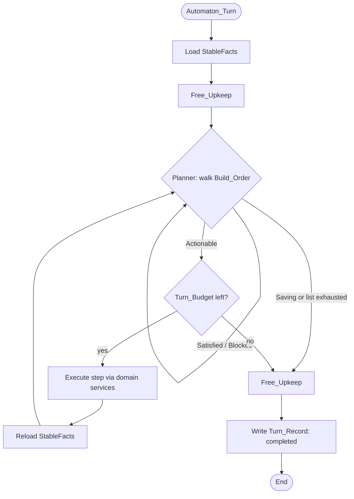
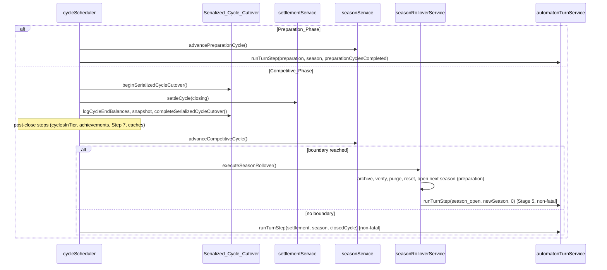

# Design Document: Automaton Stables

**Spec**: 55 — `automaton-stables`
**Status**: Proposed technical design — no application code is implemented by this document
**Requirements**: `requirements.md` (R1–R14)
**Content source of truth**: `review/` (Review_Pack). Strategy Build_Orders, parameter bounds/defaults, Build_Focus weights, Catalogue_Entries and all human-visible text are defined there. This design references them and does not duplicate them.

---

## 1. Overview

Automaton_Stables are persistent, themed, computer-run stables that play by human rules. Each is an Automaton_Profile (identity, Upgrade_Strategy, Strategy_Parameters, Team_Names, Event_Order, Robot_Blueprints) that survives every Season_Rollover, linked — once activated — to an ordinary `User` row with `stableType = automaton` and `isGenerated = false`. Because `isGenerated` is false, the existing Season_Rollover archives and resets the Automaton exactly like a human; the persistent profile then lets the Automaton rebuild itself.

After every settlement close (and after a Season_Rollover), a Turn_Step gives each Active_Automaton one Automaton_Turn. A pure planner walks the Upgrade_Strategy's Build_Order of Goals and returns the first Actionable step, or stops on Saving; an executor carries out the step through the same domain services and Credit_Mutation_Service paths that player routes use, then re-reads the stable and repeats. Free_Upkeep (teams, subscriptions, blueprint sync, tuning) runs at the start and end of each turn. Automatons never call Manual_Repair; Automatic_Repair charges them the full quote.

Operators manage Automatons in Admin_Automaton_Control on any environment. Reviewed definitions travel between environments as repository Catalogue_Entries, inserted as Draft_Automatons by an insert-only Catalogue_Sync on every deploy; its only change to an existing profile is filling a missing Robot_Blueprint image from its Repository_Image (§15.2).

The existing Generated_Stable population (`generateBattleReadyUsers`, seeded `test_user_*`) is untouched.

## 2. Goals and non-goals

### Goals

- Explicit `User.stableType` classification with the invariant `isGenerated ⇔ stableType = generated` (R1).
- Draft → Active lifecycle, Program_Switch, and no login/token/password-reset access for Automaton accounts (R2).
- Persistent Robot_Blueprints with human-equivalent rename and edit rules (R3).
- Build_Focus presets, a Goal_Library and a deterministic planner with save-vs-blocked semantics (R4, R5).
- Six versioned, conformance-tested Upgrade_Strategies defined as Strategy_Definition_Files, with admin-editable bounded Goal_Targets, a Strategy_Library and a Strategy_Builder whose exports reach stables only through a tested pull request (R6).
- Exactly-once Automaton_Turns at safe points in settlement, preparation and rollover, isolated from settlement failure (R7).
- Every charge through extracted domain services and Credit_Mutation_Service; no grants; no Manual_Repair (R8).
- Persistence across Season_Rollover with archive Stable_Type (R9).
- Repository catalogue, Repository_Images by convention, insert-only sync with a fill-only image exception on ACC deploys, export/unpack, Coverage_Matrix (R10).
- Admin API/UI with preview, audit and observability, responsive from 320 px (R11).
- Automaton_Badge and profile text (R12), all gated by Content_Approval (R13), with full test and documentation coverage (R14).
- The 11 starter Automaton_Stables (decision 32), competing with full parity: promotions, tournaments, season accolades, Hall of Records and season archive exactly like Human_Stables (decision 33); matchmaking is unchanged (non-goal below, decision 34).

### Non-goals

- Replacing `User.isGenerated` with `stableType` across the codebase, or changing the Generated_Stable generator, seed bots or `deleteGeneratedStables` (future spec).
- Competitive-balance targets as release gates. Balance is tuned later through Strategy_Parameters on ACC; this spec only requires engine correctness.
- Manual repair, selling robots, disbanding or swapping teams, or renaming robots on behalf of Automatons.
- Matchmaking changes: Automatons are matched like any stable (no code in `services/matchmaking` filters by stable kind today).
- Messaging, trading or login for Automaton accounts.
- A live strategy builder that changes Automaton behaviour without a pull request and CI run (rejected option c, D5).
- New Goal types without a code change: the Goal_Library is code; Strategy_Definition_Files only combine its types.

## 3. Verified current state

Facts this design depends on, with the file each was read from.

| Area | Fact | Source |
|---|---|---|
| Identity | `User.isGenerated Boolean @default(false)`; `stableName String? @unique VarChar(30)`; `passwordHash` not nullable; `currency @default(3000000)`; `hasCompletedOnboarding` | `app/backend/prisma/schema.prisma` (`model User`) |
| Login | `POST /login` looks up via `findUserByIdentifier`, returns generic `401 Invalid credentials` for unknown user and bad password | `app/backend/src/routes/auth.ts` |
| Token check | `authenticateToken` loads `tokenVersion`, `stableName`, `role` and rejects mismatches | `app/backend/src/middleware/auth.ts` |
| Password reset | `resetPassword(targetUserId, newPassword, initiator)` is the single reset path (admin) | `app/backend/src/services/auth/passwordResetService.ts` |
| Admin filter | `buildUserFilter('all' \| 'real' \| 'auto')` is username-prefix based; Zod enums in `routes/adminAnalytics.ts`; consumers `adminSystemStatsService.ts`, `adminFeatureAnalyticsService.ts`, `routes/adminUsers.ts`; UI `AdminFilterBar` | `app/backend/src/utils/buildUserFilter.ts` |
| Settlement | `executeSettlement`: preparation early return after `advancePreparationCycle()`; `beginSerializedCycleCutover` → `settleCycle` → `logCycleEndBalances` → `logCycleComplete` → snapshot → `completeSerializedCycleCutover`; post-close steps incl. Step 7 `generateBattleReadyUsers`, leaderboard refresh; then `advanceCompetitiveCycle()` and `executeSeasonRollover({ trigger: 'settlement' })` on `boundaryReached` | `app/backend/src/services/cycle/cycleScheduler.ts` |
| Cutover | While closing, non-settlement writers fail closed (`resolveFinancialWriteCycle`, `runFinancialWriteTransaction`); flags live in `cycleMetadata.featureFlags` and are rewritten by the cutover functions | `app/backend/src/services/cycle/canonicalCycleIdentity.ts`, `services/cycle/financialWriteTransaction.ts` |
| Admin bulk cycle | Own preparation loop (`advancePreparationCycle`); per competitive cycle `beginSerializedCycleCutover` → `settleCycle` → `logCycleEndBalances` → `completeSerializedCycleCutover`; **does not call** `advanceCompetitiveCycle` or `executeSeasonRollover` | `app/backend/src/services/admin/adminCycleService.ts` |
| Rollover | Stage 1 archive, Stage 2 `verifyArchive` (counts `isGenerated:false`), `recordGeneratedStableCount`, Stage 3 `deleteGeneratedStables()` → `resetCompetitiveAndEconomicState()` → `purgeHistory()` → `completeSeasonAndOpenNext`, Stage 4 non-fatal `cleanupSeasonOrphans()`, `reawardPreservedStateAchievements()`, `reclaimSpace()` | `app/backend/src/services/season/seasonRolloverService.ts` |
| Human reset | Deletes all subscriptions, standings, tuning, refinements, achievements, robots, weapon inventory, facilities, team battles, scheduled matches, tournaments; then `user.updateMany({ where: { isGenerated: false } })` sets `currency = STARTING_CREDITS` (3,000,000), prestige 0, titles 0 | `app/backend/src/services/season/seasonPurgeService.ts` |
| History purge | `TRUNCATE` of a fixed table list; resets `cycleMetadata.totalCycles` (keeps `featureFlags`) | `seasonPurgeService.ts` `purgeHistory` |
| Archive | `humanStables` query `isGenerated:false`; `SeasonStandingSnapshot`/`SeasonAccolade.isGeneratedSubject` derived from `isGenerated` | `app/backend/src/services/season/seasonArchiveService.ts` |
| Preserved achievements | Re-award for `isGenerated:false, hasCompletedOnboarding:true` | `app/backend/src/services/achievement/preservedStateAchievements.ts` |
| Credit writes | `applyCreditMutation`, `applyCreditMutationInTransaction`; taxonomy in `TRANSACTION_TYPES`; idempotency by `financialEventId`; `buildPurchaseBreakdown` | `app/backend/src/services/financial/creditMutationService.ts`, `types/financialTypes.ts` |
| Request identity | `createEconomicRequestIdentity(userId, operation, requestKey, facts)` for `weapon_purchase`, `weapon_sale`, `weapon_refinement`, `facility_upgrade`, `robot_creation`, `attribute_upgrade` | `app/backend/src/services/financial/economicRequestReplayService.ts` |
| Service-callable | `createRobotTransaction(userId, name, requestKey)` (₡500,000, capacity check, creates `league_1v1` and `koth` standings); `executeUpgradeTransaction(userId, robotId, upgrades, requestKey)`; `equipMainWeapon`, `equipOffhandWeapon`, `unequip*`, `changeLoadoutType`; `setSubscriptionsForRobot`; `registerTeam` + `createInitialTeamStandings`; `setTuningAllocation` | `services/robot/*`, `services/subscription/subscriptionService.ts`, `services/team-battle/*`, `services/tuning-pool/*` |
| Teams | `TeamBattle.teamName String @db.VarChar(32)` has no unique index; `registerTeam` validates the name with `validateTeamName` (3–32 characters, `safeName`), rejects `TEAM_MEMBER_CONFLICT`, does not require unique names and, despite its doc comment, does not check subscriptions; matchmaking pairs a team only when every member is subscribed to the event; `registerTeam` stores the members in the order of `robotIds` as `TeamBattleMember.slotIndex`; Tag Team treats `slotIndex` 0 as the active robot and 1 as the reserve | `app/backend/prisma/schema.prisma` (`model TeamBattle`), `services/team-battle/teamBattleService.ts`, `utils/securityValidation.ts`, `services/team-battle/teamBattleMatchmakingService.ts`, `services/tag-team/tagTeamMatchmakingService.ts`, `services/tag-team/tagTeamScheduler.ts`, `services/tournament/teamTournamentService.ts` |
| Subscriptions | `SUBSCRIBABLE_EVENT_TYPES` has 9 types; `setSubscriptionsForRobot` counts held event types as occupied slots and throws `SUBSCRIPTION_CAP_EXCEEDED` when desired ∪ held exceeds the cap | `services/subscription/eventRegistry.ts`, `services/subscription/subscriptionService.ts` |
| Route-embedded | Facility upgrade (`routes/facility.ts`), weapon purchase / sale / refinement (`routes/weaponInventory.ts`), stance and yield updates (`routes/robots.ts`) | listed files |
| Repair | Automatic `repairRobotsForEvent` before each battle job, full quote; Manual `repairAllRobots` with `MANUAL_REPAIR_DISCOUNT = 0.5` | `services/economy/repairService.ts`, `services/robot/robotRepairService.ts`, `app/shared/utils/repairCost.ts` (defines `MANUAL_REPAIR_DISCOUNT`) |
| Economy | Facility costs and `PRESTIGE_GATES_10`; operating costs incl. ₡500/day per additional robot; Training discount `min(90, L × max(0, 10 − capacity))`; Workshop discount `10 × L`; resale `10 × L %` of `pricePaid`; refinement tiers/costs/caps; Booking_Cap `3 + L`; tuning pool `(L + 1) × 10` | `config/facilities.ts`, `utils/economyFormulas.ts`, `services/financial/settlementService.ts`, `app/shared/utils/discounts.ts`, `app/shared/utils/weaponRefinement.ts`, `config/subscriptions.ts`, `services/tuning-pool/tuningPoolConfig.ts` |
| Weapons | 47 catalogue weapons upserted by name (`WEAPON_DEFINITIONS`); `canEquipToSlot` loadout rules | `app/backend/prisma/seed.ts`, `utils/weaponValidation.ts` |
| Images | Robot uploads processed to 512×512 WebP and stored in `uploads/user-robots/{userId}/`; both orphan sweeps scope to that directory only; `/uploads/*` served statically by Express and Caddy; admin changelog images in `uploads/changelog/` | `services/moderation/*`, `app/Caddyfile`, `app/backend/src/index.ts`, `services/changelog/changelogImageService.ts` |
| Deploy | The ACC job runs `prisma migrate deploy` then `prisma db seed` | `.github/workflows/deploy.yml` |
| Achievement rarity | `refreshRarityCache` excludes only `auto_*` and `test_user_*` usernames, so `automaton_*` users count as active players in rarity percentages | `services/achievement/achievementQueries.ts` |
| Alerts | `notify` in `seasonRolloverService.ts` is private and wraps `sendMonitoringAlert` | `utils/monitoringWebhook.ts` |
| Job serialisation | `cycleScheduler.ts` serialises its own jobs with an in-process mutex (`acquireLock`); `adminCycleService.ts` does not take it, and the codebase only uses transaction-scoped `pg_advisory_xact_lock` | `services/cycle/cycleScheduler.ts`, `services/admin/adminCycleService.ts` |
| Weapons | No code path deletes a `weapons` row; `seedWeapons` upserts by name | `prisma/seed.ts` |
| Tests | Tier classification in `app/backend/jest.tiers.js` (`HEAVY_TESTS` → `DB_DEPENDENT` → unit); Playwright `testDir: ./tests/e2e` | `app/backend/jest.tiers.js`, `app/frontend/playwright.config.ts` |

## 4. Alternatives and decisions

### D1 — When Automatons spend

| Option | Assessment |
|---|---|
| Inside the Serialized_Cycle_Cutover, with `cycleAssignment: 'closing'` | Every domain service would need a closing-cycle mode, `logCycleEndBalances` must still equal `usersProcessed`, and a failing Automaton would abort the cycle close. High risk. |
| A separate cron job | Extra scheduling surface; needs its own ordering against settlement and rollover. |
| **After the close, as the last step of settlement (chosen)** | Uses the normal "current cycle" write path the routes use; purchases book to the new cycle exactly like a human buying after settlement; on the season's final cycle the rollover runs first, so no money is spent before the wipe. Preparation needs one extra call site. |

### D2 — Lifecycle controls

Per-stable pause/retire was rejected: it adds states nobody needs once a stable is approved, and it invites half-built stables in matchmaking. Chosen: one-way Draft → Active (Draft prepares content invisibly) plus one global Program_Switch for incidents.

### D3 — Draft storage

| Option | Assessment |
|---|---|
| Draft as a `User` row with `stableType = automaton` | Reserves the stable name, but a draft would be archived, reset, re-awarded achievements and could appear in search and lists unless every query learns about drafts. |
| **Draft as an Automaton_Profile with no `User` (chosen)** | Drafts are invisible by construction. Stable-name uniqueness is checked against `User.stableName` and other profiles' `plannedStableName` at save, sync and Activation. Activation mirrors a human registering mid-season. |

### D4 — Getting definitions into an environment

| Option | Assessment |
|---|---|
| Bundle import through the admin page | Fast, but nothing is reviewed in git and CI cannot validate it. |
| Code-only definitions | No admin editing; contradicts the requirement to add stables from the admin page. |
| **Repository catalogue + insert-only Catalogue_Sync + admin Catalogue_Export (chosen)** | Reviewed in PRs, validated in CI, never overwrites edits made in the admin page (the one exception to insert-only fills an image only where none is set, §15.2); no reverse sync and no conflict resolution needed. This spec wires the sync into the ACC deploy only. The sync script is environment-independent, so the future PRD spec only has to add the same deploy step. |

### D5 — Strategy definition

| Option | Assessment |
|---|---|
| a — Strategies as TypeScript modules, read-only Strategy_Library in the admin page | Safe, but every new strategy needs a developer to write code. |
| **b — Strategies as Strategy_Definition_Files interpreted by the code Goal_Library; Strategy_Builder exports a file that reaches stables only through a pull request (chosen)** | An administrator designs strategies in the page; every file passes the conformance suite and the generic scenario test in CI before any stable can use it; profiles stay pinned to their Strategy_Version until an admin upgrades them. New Goal types remain code changes. |
| c — Live builder: drafts assignable directly in the admin page | Fastest iteration, but an untested strategy could spend real stables' credits; rejected. |

The conformance suite (fast-check over each file's full Goal_Target space) proves every allowed Goal_Target combination safe, so Goal_Target edits in the admin page need no further testing.

### D6 — Attribute spread

Level bands, group-by-group and per-attribute lists were considered. Chosen: Build_Focus presets (group weights) that set each group's milestone target and the order in which groups are raised: group by group in priority order across all robots, lowest attribute first (R4.3, decision 18). Level bands are the Versatile preset.

### D7 — Program_Switch storage

`cycleMetadata.featureFlags` is rewritten as a whole by the cutover functions (`{ ...remainingFlags }`), so an admin toggle concurrent with a cutover could be lost. Chosen: a dedicated single-row table `automaton_program_settings`.

### D8 — Turn identity

Using the season's `competitiveCyclesCompleted` as the turn counter fails for admin bulk cycles, which do not advance the season counter. Chosen: Turn_Slot = closed global cycle number for `settlement` (unique per season because `totalCycles` resets only at rollover), `preparationCyclesCompleted` for `preparation`, 0 for `season_open`; the Turn_Record key includes the season number.

## 5. Architecture

### 5.1 Components

```mermaid
graph TD
    subgraph Admin
        UI[/admin/automatons page/] --> API[routes/adminAutomatons.ts]
        API --> PROFILE[automatonProfileService]
        API --> PREVIEW[turnPreview]
        API --> DRAFTS[strategyDraftService]
        DRAFTS --> SCEN[scenarioProjector (pure)]
        DRAFTS --> REG
        API --> UPG[strategyUpgradeService]
        UPG --> MIG[migrateTargets (pure)]
        API --> CMP[Strategy_Comparison: strategyComparisonService]
        API --> NEED[needAttention]
        API --> EXPORT[automatonCatalogueService.export]
        API --> SWITCH[programSwitch]
        API --> IMG[automatonImageService]
    end

    subgraph Deploy
        CAT[(prisma/automaton-catalogue/*.json)] --> SYNC[scripts/automatonCatalogueSync.ts]
        SYNC --> PROFILE
    end

    subgraph Settlement
        SCHED[cycleScheduler.executeSettlement] --> STEP[automatonTurnService.runTurnStep]
        BULK[adminCycleService] --> STEP
        ROLL[seasonRolloverService] --> STEP
    end

    STEP --> TURN[runAutomatonTurn]
    TURN --> FACTS[stableFacts loader]
    TURN --> UPKEEP[Free_Upkeep]
    TURN --> PLANNER[turnPlanner (pure)]
    PLANNER --> REG[Strategy_Registry]
    PLANNER --> GOALS[Goal_Library]
    GOALS --> FOCUS[Build_Focus]
    TURN --> EXEC[actionExecutor]
    PREVIEW --> PLANNER
    PREVIEW --> PROJ[factProjector (pure)]
    EXEC --> FIT[robotFitout]
    EXEC --> DS[Domain services]
    UPKEEP --> DS

    DS --> RC[robotCreationService]
    DS --> RU[robotUpgradeService]
    DS --> FU[facilityUpgradeService *new*]
    DS --> WP[weaponPurchaseService / weaponSaleService / weaponRefinementService *new*]
    DS --> RW[robotWeaponService]
    DS --> RS[robotSettingsService *new*]
    DS --> SUB[subscriptionService]
    DS --> TEAM[registerTeam + createInitialTeamStandings]
    DS --> TUNE[tuningPoolService]
    RC --> CMS[Credit_Mutation_Service]
    RU --> CMS
    FU --> CMS
    WP --> CMS
    CMS --> FP[(Financial_Pair)]
```

### 5.2 Turn loop



### 5.3 Settlement and rollover sequence



## 6. Data model

All shapes below are design-level; the migration is written in Task 1.

### 6.1 Prisma changes

```prisma
enum StableType {
  human
  generated
  automaton
}

model User {
  // ... existing fields ...
  stableType        StableType        @default(human) @map("stable_type")
  automatonProfile  AutomatonProfile?
  @@index([stableType])
}

enum AutomatonStatus {
  draft
  active
}

model AutomatonProfile {
  id                    Int             @id @default(autoincrement())
  catalogueKey          String          @unique @map("catalogue_key") @db.VarChar(40)
  userId                Int?            @unique @map("user_id")
  user                  User?           @relation(fields: [userId], references: [id], onDelete: Restrict)
  /// Stable name while Draft. Cleared at Activation; afterwards User.stableName is authoritative.
  plannedStableName     String?         @unique @map("planned_stable_name") @db.VarChar(30)
  /// Admin-only for now; player display is backlog item #61.
  franchise             String          @db.VarChar(60)
  /// Backstory: admin-only in-world flavour text about the stable as a whole, 1–400 characters.
  backstory             String          @db.VarChar(400)
  strategyKey           String          @map("strategy_key") @db.VarChar(40)
  strategyVersion       Int             @map("strategy_version")
  strategyParameters    Json            @map("strategy_parameters")
  /// Team_Names in Team_Rule order (TeamNames shape, §6.2).
  teamNames             Json            @default("{\"twoVsTwo\":[],\"threeVsThree\":[]}") @map("team_names")
  /// Event_Order: all 9 SUBSCRIBABLE_EVENT_TYPES, each once (EventOrder shape, §6.2).
  eventOrder            Json            @map("event_order")
  status                AutomatonStatus @default(draft)
  origin                String          @db.VarChar(20) // 'catalogue' | 'admin'
  activatedAt           DateTime?       @map("activated_at")
  createdAt             DateTime        @default(now()) @map("created_at")
  updatedAt             DateTime        @updatedAt @map("updated_at")
  blueprints            AutomatonRobotBlueprint[]
  turns                 AutomatonTurn[]
  @@index([status])
  @@map("automaton_profiles")
}

model AutomatonRobotBlueprint {
  id                  Int              @id @default(autoincrement())
  profileId           Int              @map("profile_id")
  profile             AutomatonProfile @relation(fields: [profileId], references: [id], onDelete: Cascade)
  slotIndex           Int              @map("slot_index")
  robotName           String           @map("robot_name") @db.VarChar(50)
  imageUrl            String?          @map("image_url") @db.VarChar(255)   // null = no image (R3.2)
  loadoutType         String           @map("loadout_type") @db.VarChar(20)
  stance              String           @db.VarChar(20)
  yieldThreshold      Int              @map("yield_threshold")
  buildFocus          String           @map("build_focus") @db.VarChar(20)
  weaponPath          Json             @map("weapon_path")
  refinementPlan      Json             @default("[]") @map("refinement_plan")
  createdAt           DateTime         @default(now()) @map("created_at")
  updatedAt           DateTime         @updatedAt @map("updated_at")
  robots              Robot[]
  @@unique([profileId, slotIndex])
  @@map("automaton_robot_blueprints")
}

model Robot {
  // ... existing fields ...
  automatonBlueprintId Int?                     @map("automaton_blueprint_id")
  automatonBlueprint   AutomatonRobotBlueprint? @relation(fields: [automatonBlueprintId], references: [id], onDelete: SetNull)
  /// Blueprint_Slot this robot occupies (equals the blueprint's slot).
  automatonSlotIndex   Int?                     @map("automaton_slot_index")
  @@index([automatonBlueprintId])
}

enum AutomatonTurnTrigger {
  settlement
  preparation
  season_open
}

enum AutomatonTurnStatus {
  in_progress
  completed
  failed
  skipped
}

model AutomatonTurn {
  id               Int                  @id @default(autoincrement())
  profileId        Int                  @map("profile_id")
  profile          AutomatonProfile     @relation(fields: [profileId], references: [id], onDelete: Cascade)
  seasonNumber     Int                  @map("season_number")
  trigger          AutomatonTurnTrigger
  slot             Int
  attempt          Int                  @default(1)
  status           AutomatonTurnStatus
  reason           String?              @db.VarChar(40) // program_off | step_budget_exhausted | turn_budget_exhausted | invalid_parameters | error code
  strategyKey      String               @map("strategy_key") @db.VarChar(40)
  strategyVersion  Int                  @map("strategy_version")
  startBalance     Int                  @map("start_balance")
  endBalance       Int?                 @map("end_balance")
  creditsSpent     Int                  @default(0) @map("credits_spent")
  creditsReceived  Int                  @default(0) @map("credits_received") // weapon_sale proceeds
  actions          Json                 @default("[]")
  goalOutcomes     Json                 @default("[]") @map("goal_outcomes")
  durationMs       Int?                 @map("duration_ms")
  startedAt        DateTime             @default(now()) @map("started_at")
  finishedAt       DateTime?            @map("finished_at")
  @@unique([profileId, seasonNumber, trigger, slot])
  @@index([seasonNumber, trigger, slot])
  @@index([profileId, startedAt])
  @@map("automaton_turns")
}

model AutomatonStrategyDraft {
  id          Int      @id @default(autoincrement())
  key         String   @db.VarChar(40)
  version     Int
  basedOn     String?  @map("based_on") @db.VarChar(50)
  definition  Json
  createdBy   Int      @map("created_by")
  createdAt   DateTime @default(now()) @map("created_at")
  updatedAt   DateTime @updatedAt @map("updated_at")
  @@unique([key, version])
  @@map("automaton_strategy_drafts")
}

model AutomatonProgramSetting {
  id                Int      @id @default(1)
  turnsEnabled      Boolean  @default(true) @map("turns_enabled")
  turnStepLeaseUntil DateTime? @map("turn_step_lease_until")
  lastSyncSummary   Json?    @map("last_sync_summary")
  updatedByUserId   Int?     @map("updated_by_user_id")
  updatedAt         DateTime @updatedAt @map("updated_at")
  @@map("automaton_program_settings")
}

// Archive subject type
model StableSeasonArchive     { /* ... */ stableType        StableType @default(human) @map("stable_type") }
model SeasonStandingSnapshot  { /* ... */ subjectStableType StableType @default(human) @map("subject_stable_type") }
model SeasonAccolade          { /* ... */ subjectStableType StableType @default(human) @map("subject_stable_type") }
```

Notes:

- `plannedStableName @unique` prevents two drafts with one name; collisions with `User.stableName` are checked in the service (different tables), inside the Activation transaction and at sync.
- `User` deletion is `Restrict` for profiles: no current path deletes `isGenerated = false` users at rollover. `app/backend/src/services/common/resetService.ts` (account reset) must be checked in Task 1.2; if it deletes users, it must reject Automaton users.
- `automaton_turns` is added to the `purgeHistory` `TRUNCATE_TABLES` list (R9.5); nothing references it.
- Migration backfill (R1.2): `UPDATE users SET stable_type = 'generated' WHERE is_generated = true;` with archive columns backfilled from `is_generated_subject` (`true` → `generated`).

### 6.2 Stored JSON shapes (`app/backend/src/types/automaton.ts`, exported from the types barrel)

```ts
export type BuildFocusKey = 'bruiser' | 'deadeye' | 'warden' | 'sprinter' | 'tactician' | 'versatile';
export type AttributeGroup = 'combat' | 'defense' | 'mobility' | 'ai';

export interface WeaponStage {
  main: string;            // catalogue weapon name
  offhand?: string;        // off-hand weapon for dual_wield (may differ from main), shield for weapon_shield
}

export interface RefinementStep {
  tier: RefinementTier;    // from app/shared/utils/weaponRefinement.ts
  hand: 'main' | 'offhand';
  targetAttribute?: RobotAttribute; // hone / augment only
  magnitude: number;       // 1 for sharpen / forge
}

/** Stored in AutomatonProfile.teamNames. Index i names the i-th Team_Rule team of that size (§7 `teamRule.ts`). */
export interface TeamNames {
  twoVsTwo: string[];      // at most 5: slots 1+2, 3+4, 5+6, 7+8, 9+10
  threeVsThree: string[];  // at most 3: slots 1–3, 4–6, 7–9
}

/** Stored in AutomatonProfile.eventOrder: all 9 SUBSCRIBABLE_EVENT_TYPES, each once, in order of preference. */
export type EventOrder = SubscribableEventType[];

/** Stored in AutomatonProfile.strategyParameters. Keys are Goal ids of the profile's Build_Order. */
export interface StrategyParametersV1 {
  targets: Record<string, number>;   // Goal id → Goal_Target (robot count, facility level, attribute level, stage index, refine step count 0–10)
}
```

There is no reserve, buffer, "give up saving" or replaced-weapons parameter: the Build_Order is the only thing that decides what is bought and when, and weapon storage follows one fixed rule (§8.6).

Reads use the `as unknown as SpecificType` cast after Zod validation, per `coding-standards.md`.

### 6.3 Invariants (tested)

| ID | Invariant |
|---|---|
| I1 | `isGenerated = true` ⇔ `stableType = generated` for every `User`. |
| I2 | `AutomatonProfile.status = active` ⇔ `userId IS NOT NULL` ⇔ the linked `User.stableType = automaton`. |
| I3 | `status = draft` ⇒ `plannedStableName IS NOT NULL`; `status = active` ⇒ `plannedStableName IS NULL`. |
| I4 | Every robot owned by an Automaton_Stable has a non-null `automatonSlotIndex`, unique within the stable, and a non-null `automatonBlueprintId` whose profile belongs to that stable: the blueprint of that slot. |
| I5 | At most one `AutomatonTurn` per `(profileId, seasonNumber, trigger, slot)`. |
| I6 | `AutomatonProgramSetting` has exactly one row (`id = 1`). |
| I7 | Every robots Goal_Target of an Automaton_Profile is at most its number of Robot_Blueprints (R3.7), counted as the buildable blueprints: the run of Blueprint_Slots 1…k with no gap (`buildableBlueprintCount`). The N-th robot is built from slot N, so a blueprint above a gap is never built. |

## 7. Module layout

```
app/backend/src/
  types/automaton.ts                         stored JSON shapes (barrel export)
  services/automaton/
    index.ts                                 public API of the module (created by task 6.2)
    buildFocus.ts                            presets, targets, academy targets, tuning split
    stableFacts.ts                           loads StableFacts for one stable (read-only)
    factProjector.ts                         pure: applies a PlannedAction to StableFacts (preview)
    pricing.ts                               pure cost functions wrapping app/shared/utils + facility table
    goals/
      goalTypes.ts                           Goal, GoalOutcome, PlannedAction, BlockedReason
      robotCountGoal.ts                      Robots → N (Robot_Chain)
      facilityGoal.ts                        Facility → level
      attributeGoal.ts                       Attributes → level (chain: academy levels)
      weaponStageGoal.ts                     Weapons → stage k | final
      refinementGoal.ts                      Refine → plan (chain: Weapons Workshop levels)
    upkeep/
      teamUpkeep.ts                          Team_Rule teams due, named from Team_Names
      subscriptionUpkeep.ts                  Event_Allocation (pure) + apply via setSubscriptionsForRobot
      blueprintSync.ts  tuningUpkeep.ts
    teamRule.ts                              pure: TEAM_RULE_2V2, TEAM_RULE_3V3, teamsForSlots(), requiredTeamNameCounts(maxRobots)
    strategies/
      strategyDefinitionSchema.ts            Zod schema + builder rules for Strategy_Definition_Files
      strategyParameters.ts                  per-version Zod schema of Goal_Targets
      registry.ts                            loads all files into Strategy_Registry; latestVersion(); startup check
      migrateTargets.ts                      version-upgrade mapping of Goal_Targets
      strategyDraftService.ts                Strategy_Draft CRUD, validation, preview, export
      strategyUpgradeService.ts              dry-run + confirmed upgrade of profiles to a newer Strategy_Version
      scenarioProjector.ts                   pure: projects a fresh ₡3,000,000 stable over turns (draft preview, scenario test)
      __tests__/                             schema, conformance, generic scenario, fixture, migrateTargets tests
    turnPlanner.ts                           pure: facts + strategy + params + blueprints → next Goal_Outcome
    actionExecutor.ts                        executes PlannedActions via domain services
    robotFitout.ts                           Robot_Chain execution and Robot_Fitout
    robotNaming.ts                           blueprint names, "Mk II" suffixing
    requestKeys.ts                           deterministic request keys
    automatonTurnService.ts                  runTurnStep / runAutomatonTurn / Turn_Records
    programSwitch.ts                         read/write AutomatonProgramSetting
    automatonProfileService.ts               CRUD, validation, Activation, blueprint edits
    automatonImageService.ts                 admin uploads in uploads/automatons/
    automatonCatalogueService.ts             schema, sync, export, unpack helpers
    automatonObservability.ts                summaries, alerts
    turnBudget.ts                            TURN_* budget constants and the budget check (task 3.9)
    turnPreview.ts                           read-only facts loader + preview loop (Turn_Preview, draft preview; task 9.4)
    needAttention.ts                         Need_Attention reasons (§17.1a; task 9.6)
    strategyComparisonService.ts             Strategy_Comparison query and 60 s cache (§17.3; task 9.7)
    __tests__/                               unit + property tests
  services/economy/facilityUpgradeService.ts          (Domain_Service_Extraction)
  services/economy/weaponPurchaseService.ts           (Domain_Service_Extraction)
  services/economy/weaponSaleService.ts               (Domain_Service_Extraction)
  services/economy/weaponRefinementService.ts         (Domain_Service_Extraction)
  services/robot/robotSettingsService.ts              (Domain_Service_Extraction: stance, yield)
  routes/adminAutomatons.ts
  config/automaton-strategies/{key}.v{n}.json         Strategy_Definition_Files (swarm, paragon, duo, trio, tycoon, generalist at v1)
app/backend/scripts/automatonCatalogueSync.ts         pnpm run automaton:sync [--dry-run]
app/backend/scripts/automatonCatalogueUnpack.ts       pnpm run automaton:unpack <file> [--force] (Catalogue_Unpack and Strategy_Unpack)
app/backend/prisma/automaton-catalogue/{catalogueKey}.json
app/frontend/public/assets/automatons/{catalogueKey}/{slot}.webp
app/frontend/src/
  components/AutomatonBadge.tsx
  components/admin/automatons/ (AutomatonStatusBar, StablesTab, StrategiesTab, EditorTab, CatalogueTab,
                                BuildOrderPanel, BlueprintEditor, TurnPreviewPanel, TurnHistoryTable,
                                StrategyComparisonTable, StrategyLibrary, StrategyBuilder, DraftPreviewPanel,
                                StrategyUpgradeDialog, StableCard, EventOrderList, TeamsCard)
  pages/admin/AutomatonsPage.tsx
  utils/automatonAdminApi.ts
```

The extracted services sit in `services/economy/` next to `repairService.ts` and `streamingRevenueService.ts` (there is no `services/facility/` or `services/weapon/` directory today), and in `services/robot/` for robot settings. `PRD_SERVICE_DIRECTORY.md` is updated with the final names (Task 13).

## 8. Engine

### 8.1 Stable facts

`loadStableFacts(tx | prisma, profileId)` performs a bounded set of reads for one stable and returns a plain object. The planner never touches the database.

```ts
interface StableFacts {
  profileId: number;
  userId: number;
  catalogueKey: string;
  seasonNumber: number;
  phase: 'preparation' | 'competitive';
  balance: number;                              // User.currency
  prestige: number;                             // User.prestige
  facilities: Record<FacilityType, number>;     // level, 0 when absent
  rosterCapacity: number;                       // getRosterCapacity(roster_expansion)
  storageCapacity: number;                      // calculateStorageCapacity(storage_facility)
  bookingCap: number;                           // getSubscriptionCap(booking_office)
  robots: RobotFacts[];                         // ordered by slotIndex
  inventory: InventoryFacts[];                  // all weapon_inventory rows of the user
  teams: TeamFacts[];                           // size, name, member robot ids
}

interface RobotFacts {
  robotId: number;
  slotIndex: number;                            // Robot.automatonSlotIndex
  blueprintId: number | null;
  attributes: Record<RobotAttribute, number>;   // Number(Decimal)
  loadoutType: LoadoutType;
  stance: Stance;
  yieldThreshold: number;
  mainInventoryId: number | null;
  offhandInventoryId: number | null;
  stageIndex: number;                           // matched Weapon_Stage, -1 when no stage matches
  mainRefinements: RefinementRow[];
  offhandRefinements: RefinementRow[];
  subscriptions: EventType[];
  heldEventTypes: EventType[];                  // held tournament slots (subscriptionService)
  tuning: Partial<Record<RobotAttribute, number>>;
}
```

`stageIndex` is the highest stage whose weapons the robot holds in every hand while its `loadoutType` equals the blueprint loadout; otherwise −1.

The weapon catalogue (`prisma.weapon.findMany()`) is loaded once per Turn_Step and passed in as a read-only map keyed by name.

### 8.2 Goal contracts

```ts
type BlockedReason =
  | 'prestige_gate' | 'max_level' | 'roster_limit' | 'no_blueprint'
  | 'awaiting_final_weapon' | 'storage_limit'
  | 'name_unavailable';
// 'storage_limit': storage is full at Storage Facility L10 and nothing unequipped can be sold; a gated Storage Facility level is 'prestige_gate'.
// 'prestige_gate' carries { facilityType, level, prestigeRequired, prestigeHeld } and covers prerequisites bought by a Goal_Chain (academies, Workshop, Roster Expansion, Storage).

type GoalOutcome =
  | { kind: 'satisfied'; goalId: string }
  | { kind: 'blocked'; goalId: string; reason: BlockedReason; detail: Record<string, number | string> }
  | { kind: 'saving'; goalId: string; cost: number; detail: Record<string, number | string> }
  | { kind: 'actionable'; goalId: string; action: PlannedAction; cost: number };

type PlannedAction =
  | { kind: 'robot_chain'; slotIndex: number; steps: ChainStep[] }            // composite
  | { kind: 'facility_upgrade'; facilityType: FacilityType; toLevel: number; cost: number }
  | { kind: 'attribute_upgrade'; robotSlot: number; increments: Partial<Record<RobotAttribute, number>>; cost: number }
  | { kind: 'weapon_stage'; robotSlot: number; toStage: number; steps: StageStep[] }   // composite
  | { kind: 'weapon_refinement'; robotSlot: number; step: RefinementStep; cost: number };

type ChainStep =
  | { kind: 'weapon_sale'; inventoryId: number; proceeds: number }              // Storage_Overflow_Rule: sale before a storage level
  | { kind: 'facility_upgrade'; facilityType: 'roster_expansion' | 'storage_facility'; toLevel: number; cost: number }
  | { kind: 'robot_purchase'; robotName: string; cost: number }
  | { kind: 'fitout' };                                                         // see §9

type StageStep =
  | { kind: 'facility_upgrade'; facilityType: 'storage_facility'; toLevel: number; cost: number }
  | { kind: 'weapon_sale'; inventoryId: number; proceeds: number }
  | { kind: 'weapon_purchase'; weaponName: string; hand: 'main' | 'offhand'; cost: number }
  | { kind: 'equip'; hand: 'main' | 'offhand' }                                // free; may include changeLoadoutType
  ;

interface Goal {
  id: string;                       // stable within a Strategy_Version, e.g. "swarm.v1.10.robots"
  evaluate(facts: StableFacts, ctx: GoalContext): GoalOutcome;
}

interface GoalContext {
  target: number;                   // this Goal's Goal_Target from params.targets[goal.id]
  params: StrategyParametersV1;
  blueprints: BlueprintFacts[];     // ordered by slot
  weapons: ReadonlyMap<string, WeaponFacts>;
  balance: number;                  // facts.balance — the only affordability input
}
```

Goal factory functions (called by `registry.ts` when it interprets a Strategy_Definition_File's `goal` entries):

| Factory | Satisfied when | Blocked when | Cost of next step |
|---|---|---|---|
| `robots()` | live robots ≥ target | next slot has no blueprint (defensive `no_blueprint`; R3.7 prevents it); roster level needed > 10; any chain facility level's Prestige_Gate unmet (`prestige_gate`); storage full at L10 with nothing unequipped to sell (`storage_limit`); no free name (`name_unavailable`) | Robot_Chain sum: missing `roster_expansion` levels + room in storage for the starting stage by the Storage_Overflow_Rule (sale first, a `storage_facility` level only when nothing unequipped is left; sale proceeds are not subtracted) + `ROBOT_CREATION_COST` + discounted weapons not covered by Weapon_Reuse |
| `facility(type)` | level ≥ target, or target 0; for `booking_office` also level ≥ the useful level (below) | next level > `maxLevel`; next level's Prestige_Gate unmet | `getFacilityUpgradeCost(type, current)` |
| `attributes()` | every attribute on every robot ≥ its target (`max(1, ceil(w × target))`, or 50 for `Max`) | all remaining work is behind prestige-gated academy levels | the next increments or academy level in priority order (§8.4); Saving if that step is unaffordable |
| `weapons()` | every robot's `stageIndex` ≥ min(target, last stage) | storage is full, no unequipped weapon can be sold and the next Storage Facility level is prestige-gated (`prestige_gate`) or above L10 (`storage_limit`) | next robot's (slot order) stage: discounted purchases for the hands that change and are not covered by Weapon_Reuse + a storage level only when nothing unequipped can be sold; sale proceeds are **not** subtracted |
| `refine()` | every live robot has applied `min(target, plan length)` steps of its Refinement_Plan, in plan order, counted per §8.6 item 7 (target 0–10 steps per robot; 0 skips the Goal, 10 = every step of a two-weapon robot) | robot not on final stage (`awaiting_final_weapon`); the Workshop level the step's tier needs has an unmet Prestige_Gate. Across robots the goal takes the next ungated within-target step in slot order: a robot whose next step is gated or that is not yet on its final stage is skipped, and the goal is Blocked (reason of the first skipped robot in slot order) only when every remaining within-target step is skipped | `calculateRefinementCost(tier, magnitude, existingInstancesOfTier)` + the missing Weapons Workshop levels (Goal_Chain) |

**Booking Office useful level** (R5.12): `useful = min(6, max over live robots of playable(r) − 3)`, with `playable(r) = 4 + (3 if r is in a formed 2v2 team) + (2 if r is in a formed 3v3 team)` and `useful = 0` with no live robots. Because teams follow the Team_Rule, this is L1 for one robot, L4 for two (robots 1 and 2 form a 2v2 team) and L6 for three or more (robots 1–3 also form a 3v3 team). A `facility('booking_office')` Goal is Satisfied at `min(target, useful)` and re-opens when `useful` rises, which happens when a team forms. All Booking Office Goal bounds are L0–L6.

Each Goal reads its Goal_Target from `params.targets[goal.id]` (falling back to the strategy default), so an admin edit changes the target without a code change. Goal ids are stable within a Strategy_Version (e.g. `swarm.v1.10.robots`); the number in the id is the Build_Order position.

### 8.3 Planner

```ts
function planNextStep(facts: StableFacts, strategy: UpgradeStrategy, ctx: GoalContext): PlanResult {
  const outcomes: GoalOutcome[] = [];
  for (const goal of strategy.buildOrder) {
    const outcome = goal.evaluate(facts, ctx);
    outcomes.push(outcome);
    if (outcome.kind === 'saving' || outcome.kind === 'actionable') {
      return { next: outcome, outcomes };
    }
  }
  return { next: null, outcomes };          // every goal Satisfied or Blocked
}
```

Properties:

- **Pure and deterministic** (R5.10): inputs are plain data; iteration order is the Build_Order, robots by slot, attributes by `ATTRIBUTE_TO_ACADEMY` order, academies Combat → Defense → Mobility → AI/Team, facilities by the order listed in `FACILITY_TYPES`.
- **Affordability** (R5.3): `cost ≤ ctx.balance`; `balance` is recomputed from fresh facts after every executed step. Nothing is held back.
- **Preview statuses** (R11.4): Turn_Preview runs the same loop with `factProjector`, then evaluates every remaining Goal once more against the projected facts without stopping, so Goals below the Saving Goal get the status Waiting plus a `gated` flag when their next step is prestige-gated. The real turn never does this extra pass.
- **No deviation while Saving** (R5.6): a Saving Goal ends the evaluation every turn until it becomes affordable (Actionable) or stops being possible (Blocked). There is no timeout and no counter; the Build_Order alone decides priority.

### 8.4 Build_Focus mathematics

Weights come from `review/STRATEGIES.md` §3 and live in `buildFocus.ts` as a frozen table.

- **Attribute target** (R4.2): `target(a) = max(1, ceil(w(g) × L))` for a milestone L (1–50); `target(a) = 50` for every group when the Goal_Target is `Max` (stored as 50 with `isMax = true` on the Goal definition). Increments are only planned up to `min(target, cap(g))` with `cap(g) = getCapForLevel(academyLevel(g))`.
- **Increment selection** (R4.3): priority order per robot = groups sorted by weight descending, ties Combat → Defense → Mobility → AI/Team (`buildFocus.ts` exports it). Steps k = 1…4: the candidate set is every robot's k-th group with `current < target`; pick the lowest `current`, ties lower slot → `ATTRIBUTE_TO_ACADEMY` order; when the pick is at `cap(g)`, the next action is that group's academy level (Goal_Chain) instead. Step k+1 starts only when step k has nothing left that is not gated. Increments are batched per robot into one `executeUpgradeTransaction` call each (each call is one charged action); cumulative cost ≤ balance.
- **Attribute cost**: identical to `robotUpgradeService` — per level `floor(calculateBaseCost(level) × (100 − calculateTrainingFacilityDiscount(trainingLevel, rosterCapacity)) / 100)`. `pricing.ts` calls the same shared functions; if `robotUpgradeService` computes the discount inline, Task 2 extracts it into a shared helper first so there is one formula (`coding-standards.md`: never duplicate a formula).
- **Academy chain** (R4.4): the level needed per group is the smallest with `getCapForLevel(level) ≥ max over live robots of target(a)`; one level is planned at a time, at the moment the step's next increment hits the cap. A gated level ends the group for this Goal evaluation (raised to the current cap); the step moves on. Blocked only when all remaining work is behind gated levels. The Training Facility is never planned by this goal. Turn_Preview returns this plan per robot for the Editor's expandable row.
- **Tuning split** (R4.5): pool `P = getPoolSize(tuningBayLevel)`; group share `P × w(g) / Σw`; within group, split evenly; clip each attribute at `getPerAttributeMax(cap, base)`; redistribute clipped surplus to unclipped attributes of the same robot in group order; round to 2 decimals using largest remainder with attribute order as tie-break. Write only when different from the current allocation.

### 8.5 Robot_Chain

For `robots(n)` with `k` live robots (`k < n`) and next slot `s = k + 1`:

1. `requiredRoster = k` (capacity `k + 1`). For each missing level up to `requiredRoster`: check Prestige_Gate; add cost.
2. Starting stage: the highest stage of blueprint `s` that Weapon_Reuse can fill for every hand from unequipped inventory; if none, stage 0, reusing what it can per hand. Weapons still to buy need slots; the Storage_Overflow_Rule (§8.6) makes room (sale first, a Storage Facility level only if nothing unequipped is left; each level checks its Prestige_Gate).
3. Add `ROBOT_CREATION_COST` and the discounted prices of the weapons still to buy (`applyDiscount(cost, calculateWeaponWorkshopDiscount(workshopLevel))`); reused weapons cost nothing.
4. Outcome: Blocked if any gate fails; Saving if `sum > balance`; otherwise Actionable with the ordered steps.

The executor runs the steps in order; each charged step is its own transaction (R7.7). If a step fails validation in its domain service (a race or planner defect), the remaining steps are abandoned, the turn records the error, and the next turn re-plans from facts — already-committed facility levels remain (as for a human whose purchase failed after an upgrade).

### 8.6 Weapon stages and sales

For `weapons(k)`, the next robot (slot order) with `stageIndex < target` moves to `stageIndex + 1` (or from −1 to 0):

1. Per hand: if the hand already holds the stage's weapon, nothing changes for that hand. Otherwise apply Weapon_Reuse: equip an unequipped inventory item with that weapon name; buy only if none exists. A `dual_wield` stage may name two different one-handed weapons.
2. Storage_Overflow_Rule (fixed, no setting): replaced weapons go to storage. If a purchase needs a slot and storage is full, sell one unequipped item — first one whose weapon name appears in no Weapon_Path of the stable's blueprints (live or not yet bought) at a stage ≥ that robot's current stage, then the one with the lowest resale value (`applyResaleRate(pricePaid, calculateWeaponResaleRate(workshopLevel))`), ties by oldest `createdAt`. Only when no unequipped item exists is a Storage Facility level planned (Goal_Chain); if that level is gated the Goal is Blocked with `prestige_gate`; at Storage Facility L10 with nothing to sell it is Blocked with `storage_limit`.
3. Order: sale (if needed) → storage level (if needed) → purchases → `changeLoadoutType` if the blueprint loadout differs → equip main → equip offhand.
4. Replaced weapons stay in inventory.
5. Fighting range is not planned: the combat engine derives it from the equipped weapons (`getPreferredRange` in `services/arena/movementAI.ts`; for two different dual-wield weapons, the range of the higher-DPS weapon, the main-hand weapon on a tie because the main hand wins when `mainDPS / (mainDPS + offDPS) ≥ 0.5`). The Editor shows that derived range per stage as information.
6. A loadout or Weapon_Path edit (R3.11) after which the robot matches no stage makes `stageIndex` −1 (§8.1), so the weapons Goal re-opens for that robot; its next step calls `changeLoadoutType` and equips stage 0, then later stages, per hand with Weapon_Reuse first. The edit itself is validated together with the Refinement_Plan (R3.4, §15.1): an edit that leaves a non-shield weapon of the new final stage without a plan step, or an `offhand` step without an off-hand weapon, is rejected, so the admin changes path and plan in the same request.
7. The refine Goal counts applied steps per weapon by number, not by content, because refinements are permanent and an R3.11 Refinement_Plan edit may no longer match what was applied:
   - A hand's applied count is the number of refinement rows on its equipped `WeaponInventory` item. That hand's first `count` plan steps (in plan order) are done, whether or not they match the applied refinements; a hand whose count is at least its number of plan steps is complete, and any extra refinements stay on the weapon.
   - A robot meets the target when every one of its first `min(target, plan length)` plan steps is done; its next step is the first plan step that is not done.
   - Before pricing that step the Goal runs the shared validators (`validateRefinementSlotAvailable`, `validateAttributeOnWeapon`, `validateAttributeStackCap`, `validateShieldCompatibility`) against the weapon's current refinements. A step they reject can never be applied (for example a changed fifth step on a weapon with 5/5 slots, a third Sharpen after the steps were reordered, or a Hone past +10), so it counts as done and the Goal takes the robot's next step; the robot is complete when no within-target step is left. Such a step is never Actionable, so it cannot hold back lower Goals or repeat a failed charge.
   - A replaced weapon (a new final stage) starts from its own count: 0 for a new purchase, its existing refinements for a stored weapon equipped through Weapon_Reuse.

   Examples, plan edited after Rex's main hand already has S S F F Hone (5/5 slots): a changed fifth step (Hone → another attribute) is rejected by `validateRefinementSlotAvailable` and counts as done; a reordered plan (S F S F …) counts the first 5 main-hand steps as done; a plan shortened to S S F on the main hand leaves that hand complete.

### 8.7 Free_Upkeep

Runs at turn start and end (R5.7), only when the Program_Switch is on. All free; none counts against the 60-action limit, but all count against the time budget.

1. **Teams** (R5.9, R3.6): `teamsForSlots(liveSlots)` (`teamRule.ts`) returns every Team_Rule team whose member slots are all alive — 2v2 slots 1+2, 3+4, 5+6, 7+8, 9+10 and 3v3 slots 1–3, 4–6, 7–9; slot 11 is in no team. For each one with no registered team of that size containing exactly those robots, in Team_Rule order (2v2 first, then 3v3): `registerTeam(userId, robotIds, teamNames.twoVsTwo[i] | teamNames.threeVsThree[i], size, userId)` then `createInitialTeamStandings(team.id, size)` — the same pair `POST /api/team-battles` uses. `registerTeam` requires neither unique names nor existing subscriptions (§3), so a team registers before Event_Allocation subscribes it in step 2. Any `registerTeam` error is recorded and retried next turn. Teams are never disbanded, swapped or renamed; a changed name in Team_Names applies only to a team registered later. `robotIds` are passed in ascending Blueprint_Slot order, so `TeamBattleMember.slotIndex` 0 is the lower slot: in Tag Team the lower Blueprint_Slot is the active robot and the higher one the reserve (§3).
2. **Subscriptions** (R5.8): Event_Allocation in `subscriptionUpkeep.ts`, a pure function of the live robots, their held event types, the registered teams, `bookingCap` and the Event_Order:

   ```ts
   const SOLO = ['league_1v1', 'koth', 'grand_melee', 'tournament_1v1'];
   const TEAM_SIZE = { league_2v2: 2, tag_team: 2, tournament_2v2: 2, league_3v3: 3, tournament_3v3: 3 };
   // desired[r] starts as the held event types of r; free(r) = bookingCap − |desired[r]|
   for (const event of eventOrder) {
     if (SOLO.includes(event)) {
       for (const r of robotsBySlot) if (!desired[r].has(event) && free(r) > 0) desired[r].add(event);
     } else {
       for (const team of formedTeams(TEAM_SIZE[event]))           // Team_Rule order
         if (team.members.every(m => desired[m].has(event) || free(m) > 0))
           team.members.forEach(m => desired[m].add(event));        // whole team or none
       // robots in no formed team of that size skip the event; skipped slots stay free for later events
     }
   }
   ```

   For every robot whose desired set differs from its current set: `setSubscriptionsForRobot(robotId, desired, userId)`. Because held event types occupy slots from the start, desired ∪ held never exceeds `bookingCap`, so `SUBSCRIPTION_CAP_EXCEEDED` cannot occur. The result is deterministic for identical facts (R5.10). An Event_Order or Booking Office change re-runs Event_Allocation at the next turn; dropping an event is an unsubscribe, which `setSubscriptionsForRobot` never refuses, and a held slot stays occupied until its match is fought. Tournaments need no special handling: the existing tournament auto-creation enters the robots subscribed when it runs, as for humans.
3. **Blueprint sync** (R3.11): stance and yield via `robotSettingsService` when different from the blueprint. Robot names (R3.9) and images (R3.10) are not synced here; loadout and Weapon_Path changes are fitted by the weapons Goal (§8.6).
4. **Tuning** (R4.5): `setTuningAllocation(robotId, userId, allocation)` when different.

### 8.8 Turn_Budget

| Limit | Value | Behaviour on reach |
|---|---|---|
| Charged actions per Automaton_Turn | 60 | stop, `reason = turn_budget_exhausted`, status `completed` |
| Wall-clock per Automaton_Turn | 10 s | same |
| Wall-clock per Turn_Step | 300 s | remaining profiles `skipped` with `step_budget_exhausted`; alert |
| Free_Upkeep | inside the turn's time budget | — |

Constants live in `turnBudget.ts` as `UPPER_SNAKE_CASE` exports, re-exported by `automatonTurnService.ts`, so tests can reference them. The opening build of the biggest starter stable (Swarm, ~15 charged actions) fits comfortably.

## 9. Robot_Fitout, naming and request keys

### 9.1 Fit-out sequence (inside the Robot_Chain, after `robot_purchase`)

1. `createRobotTransaction(userId, name, requestKey)` — charges ₡500,000, creates `league_1v1` and `koth` standings (existing behaviour).
2. Link: `Robot.automatonBlueprintId = blueprint.id` (the blueprint of slot `s`) and `Robot.automatonSlotIndex = s`; set `imageUrl` from the blueprint, which may be null (direct column write in the Automaton module; not a currency write).
3. `changeLoadoutType` to the blueprint loadout (a new robot has no weapons, so this always succeeds).
4. `robotSettingsService.updateStance` and `updateYieldThreshold`.
5. Equip the starting stage: reuse unequipped weapons, purchase the rest (`weaponPurchaseService`), equip main then offhand (`equipMainWeapon`, `equipOffhandWeapon`).
6. Run Free_Upkeep's team and subscription parts for the stable (registers a team if this robot completes a Team_Rule team; subscribes the robots through Event_Allocation).
7. Tuning allocation for the robot.

A robot is therefore armed, configured, subscribed and teamed before the turn ends (R5.4, R14.3).

### 9.2 Names (R3.9, review `CATALOGUE.md` §2)

- Slot `s` → `blueprint.robotName`. Every robot has a blueprint: robots Goal_Targets never exceed the number of blueprints (R3.7), so no other naming rule is needed.
- If `validateRobotName` reports the name taken: try `"{name} Mk II"`, `"… Mk III"` … `"… Mk X"`, trimming the base so the result is ≤ 50 characters. If all are taken the Robot_Chain is Blocked with `name_unavailable` and an alert is raised.

### 9.3 Request keys (R7.7)

`automaton:{profileId}:s{seasonNumber}:{trigger}:{slot}:a{attempt}:{ordinal}` where `ordinal` counts charged steps within the attempt (1-based). Passed as `requestKey` to every service that accepts one (`createRobotTransaction`, `executeUpgradeTransaction`, and the extracted services), which derive `financialEventId` through `createEconomicRequestIdentity`. A replay with the same key and facts returns the original result; a different action under the same key fails closed with `EVENT_CONFLICT`, which the turn records as `failed`. Task 5 confirms the key fits the `financialEventId` length (≤ 191).

### 9.4 Audit context (R8.2)

The extracted services and existing services accept an optional `auditContext` extension. Automaton calls pass `{ automaton: { catalogueKey, strategyKey, strategyVersion, trigger, slot, attempt, goalId } }`, merged into the existing `buildEconomicRequestAuditContext` output and stored on the `AuditLog` row of the Financial_Pair.

## 10. Domain_Service_Extraction (R8.6)

Each extraction keeps the route's request validation in the route and moves everything after validation into a service. The route then calls the service and returns its result unchanged. Behaviour contract: same responses, status codes, error codes, ledger rows, audit rows and achievement checks; existing tests pass with unchanged assertions.

| Service (new) | Signature (design) | Moved from | Notes |
|---|---|---|---|
| `facilityUpgradeService.upgradeFacility` | `(userId, facilityType, requestKey, options?: { auditContext? }) → { facility, currency, ... }` | `routes/facility.ts` upgrade handler | Exports `getFacilityUpgradeRequirement(type, currentLevel) → { cost, prestigeRequired, maxLevel }` for the planner. |
| `weaponPurchaseService.purchaseWeapon` | `(userId, weaponId, requestKey, options?) → { inventoryItem, currency, ... }` | `routes/weaponInventory.ts` purchase handler | Storage check, Workshop discount, `weapon_purchase` mutation. |
| `weaponSaleService.sellWeapon` | `(userId, inventoryId, requestKey, options?) → { proceeds, currency }` | `routes/weaponInventory.ts` sale handler | Must refuse to sell an equipped item exactly as the route does today. |
| `weaponRefinementService.refineWeapon` | `(userId, inventoryId, { tier, targetAttribute?, magnitude }, requestKey, options?) → { refinement, currency }` | `routes/weaponInventory.ts` `/:id/refine` | Uses the shared validators and `calculateRefinementCost`. |
| `robotSettingsService.updateStance` / `updateYieldThreshold` | `(userId, robotId, value) → robot` | `routes/robots.ts` stance and yield handlers | Ownership check and the `stance_changed` achievement call stay identical. |

Achievement checks (`achievementService.checkAndAward`) that routes perform after a purchase move into the services' callers. To keep Automatons earning the same achievements as humans, the Automaton executor calls the same `checkAndAward` events after each action, wrapped in the same "failures don't block" pattern. Achievements that only a manual action can trigger (for example Manual_Repair or practice battles) are never earned by Automatons, because they never take those actions. Every achievement triggered by a purchase, battle, standing or season result is earned exactly as by a human (decisions 3 and 33). Achievement rarity keeps counting humans only (R1.8, decision 38): `refreshRarityCache` (`services/achievement/achievementQueries.ts`) adds `stableType: { not: 'automaton' }` to the `userAchievement.groupBy` user filter and `AND u.stable_type <> 'automaton'` to the active-player count, next to the existing `auto_` and `test_user_` exclusions. Automatons still earn achievements; only the percentage shown to players ignores them.

## 11. Turn runner and integration points

### 11.1 `runTurnStep`

```ts
export async function runTurnStep(input: {
  trigger: AutomatonTurnTrigger;
  seasonNumber: number;
  slot: number;
  source: 'scheduler' | 'admin_bulk' | 'rollover';
}): Promise<TurnStepSummary> {
  await assertNoCutoverInProgress();                          // R7.5
  return withTurnStepLease(async () => {                       // serialises scheduler vs admin bulk
    const started = Date.now();
    const enabled = await programSwitch.isEnabled();
    const cohort = await listActiveProfilesOrderedByUserId(); // fixed at start (R7.9)
    const weapons = await loadWeaponCatalogue();
    const summary = emptySummary(input);
    for (const profile of cohort) {
      if (Date.now() - started > TURN_STEP_BUDGET_MS) {       // R7.10
        await markSkipped(profile, input, 'step_budget_exhausted'); summary.skipped++; continue;
      }
      const record = await claimTurnRecord(profile, input);   // upsert on unique key (R7.6)
      if (record.alreadyFinal) continue;                      // completed | skipped
      if (!enabled) { await finish(record, 'skipped', 'program_off'); summary.skipped++; continue; }
      try {
        const result = await runAutomatonTurn(profile, record, weapons);
        summary.add(result);
      } catch (error) {
        await finish(record, 'failed', errorCodeOf(error));  // R7.8
        alert('automaton_turn_failed', { catalogueKey: profile.catalogueKey, error });
        summary.failed++;
      }
    }
    logSummary(summary, Date.now() - started);                // R11.7
    if (summary.budgetExhausted) alert('automaton_step_budget_exhausted', summary);
    return summary;
  });
}
```

`withTurnStepLease` (new, in `automatonTurnService.ts`) claims `automaton_program_settings.turnStepLeaseUntil` with one conditional `updateMany` (`id = 1` and the lease null or expired) setting it to now + `TURN_STEP_BUDGET_MS` + 60 s, polls every second while another caller's lease is live, and clears the lease in `finally`. It serialises the scheduler and admin bulk cycles across processes; an expired lease (crashed holder) is taken over.

`claimTurnRecord`: inserts `(profileId, seasonNumber, trigger, slot)` with `status = in_progress, attempt = 1`; on unique conflict reads the row: `completed`/`skipped` → `alreadyFinal`; `in_progress`/`failed` → `attempt + 1` and `status = in_progress` (re-plan from fresh facts, R7.6).

### 11.2 `runAutomatonTurn`

1. Strategy resolution: `getStrategy(strategyKey, strategyVersion)` for the profile's pinned version (never the latest; upgrades happen only through §14.0a), then validate the stored Goal_Targets with that version's `parameterSchema` (R6.6) — a missing version or invalid targets ends the turn `failed` / `invalid_parameters` with an alert.
2. `facts = loadStableFacts()`; record `startBalance`; alert if `startBalance < 0` (R11.8).
3. Free_Upkeep.
4. Loop: `planNextStep` → stop on `null` or Saving → check Turn_Budget → `actionExecutor.execute(next.action)` → reload facts.
5. Free_Upkeep.
6. Write `endBalance`, `creditsSpent`, `creditsReceived`, `actions`, `goalOutcomes` (the final evaluation's outcomes), `durationMs`, status `completed`.

Notes:

- Negative balance: the turn still runs and Free_Upkeep runs at start and end. Every charged step fails `balance ≥ cost` (R5.3) — also a step whose cost is 0 because Weapon_Reuse covers it — so the Build_Order ends on the first Goal that is neither Satisfied nor Blocked; the turn-start alert fires (R11.8) and the stable shows Balance negative (R11.12).
- Activation mid-season: the profile joins the cohort at the next Turn_Step (R7.9); that turn builds its opening roster from ₡3,000,000, like a human registering mid-season. A profile activated after a season's last non-boundary settlement takes its first turn in the next season's `season_open` step, because the boundary settlement runs no `settlement` turn (R7.2).

### 11.3 Call sites

| Call site | Where | Turn_Trigger / Turn_Slot | Failure handling |
|---|---|---|---|
| `cycleScheduler.ts` `executeSettlement`, preparation branch | after `advancePreparationCycle()` logs, before `return` | `preparation` / `advanced.preparationCyclesCompleted`, season `advanced.seasonNumber` | try/catch, log + alert, never rethrow (R7.8) |
| `cycleScheduler.ts` `executeSettlement`, competitive | after `advanceCompetitiveCycle()`; only when `!advanced.boundaryReached` | `settlement` / `closingCycle` | same |
| `seasonRolloverService.ts` `executeSeasonRollover` | new Stage 5 after `reclaimSpace()` | `season_open` / 0, season `newSeasonNumber` | inside the existing non-fatal pattern; covers scheduler- and admin-triggered rollovers (R7.2) |
| `adminCycleService.ts` preparation loop | after each `advancePreparationCycle()` | `preparation` / `advanced.preparationCyclesCompleted` | try/catch, recorded in the bulk result |
| `adminCycleService.ts` competitive loop | after `completeSerializedCycleCutover(claimedClosingCycle)` and the counters step | `settlement` / `currentCycleNumber` | try/catch, recorded in the bulk result |

`assertNoCutoverInProgress` reads the closing flag through `canonicalCycleIdentity.ts`; it is a defensive check — all call sites are already after `completeSerializedCycleCutover`.

**Season boundary**: when `boundaryReached`, no `settlement` turn runs for the completed season (R7.2), so Automatons do not spend credits that the reset will erase; the rollover's Stage 5 then gives each Automaton its `season_open` turn in the new season.

**Rollover failure**: if `executeSeasonRollover` throws, settlement rethrows today; no Automaton turn runs for that settlement, and the retried rollover runs Stage 5.

## 12. Season_Rollover interaction (R9)

| Stage | Automaton effect | Change needed |
|---|---|---|
| Archive | Active_Automatons are `isGenerated = false`, so `humanStables` includes them | Write `stableType` to `StableSeasonArchive`; write `subjectStableType` alongside `isGeneratedSubject` in snapshot and accolade rows |
| Verify | Counts include Active_Automatons on both sides | none |
| `deleteGeneratedStables` | Only `isGenerated = true` | none (a test asserts Automaton users survive, R9.2) |
| `resetCompetitiveAndEconomicState` | Human_Reset_Contract applies | none |
| `purgeHistory` | Turn_Records removed | add `automaton_turns` to `TRUNCATE_TABLES` |
| Stage 4 `cleanupSeasonOrphans` | scoped to `uploads/user-robots/` | none; a test asserts `uploads/automatons/` is untouched (R9.8) |
| Stage 4 `reawardPreservedStateAchievements` | Active_Automatons have `hasCompletedOnboarding = true`, so they are re-awarded like humans (decided: parity) | none (R9.7) |
| Stage 5 (new) | `season_open` Turn_Step | new |

Automaton_Profiles (including team names and event orders), blueprints, parameters, `automaton_program_settings` and Automaton_Image_Store files are in tables and directories no rollover stage touches (R9.3). `Robot.automatonBlueprintId` rows disappear with the robots.

## 13. Identity, access and exposure (R1, R2, R12)

- **Login** (R2.9): in `POST /login`, after `if (!user)`, add `if (user.stableType === 'automaton') throw new AuthError(INVALID_CREDENTIALS, 'Invalid credentials', 401)` — before `bcrypt.compare`. `findUserByIdentifier` must select `stableType`.
- **Token** (R2.10): `authenticateToken` selects `stableType` and rejects `automaton` with the existing 401 path.
- **Password reset** (R2.11): `resetPassword` reads `stableType` inside its transaction and throws `AuthError` code `AUTOMATON_ACCOUNT_LOCKED` (409) before hashing. Added to `docs/guides/ERROR_CODES.md` in Task 13.
- **Password hash**: `hashPassword(randomBytes(32).toString('hex'))`, never stored or logged in plain form.
- **Filters** (R1.6): `UserFilterType = 'all' | 'real' | 'auto' | 'automaton'`; `real` → existing `NOT` list plus `{ stableType: { not: 'automaton' } }` combined with `AND`; `automaton` → `{ stableType: 'automaton' }`. All Zod `filter` enums in `routes/adminAnalytics.ts` and `routes/adminUsers.ts` gain `automaton`; frontend filter types and `AdminFilterBar` gain the option.
- **Public exposure** (R1.7, R12): every query feeding `OwnerNameLink`, `StableViewPage`, `RobotDetailPage` (robot owner select), `BattleResultBanner`, `TeamBattleMetrics` and `SeasonArchivePage` adds `stableType` to its owner `select`. No other profile field is selected for non-admin routes; a sanitizer test asserts the absence of `franchise`, `backstory`, `strategyKey`, `strategyParameters`, `teamNames`, `eventOrder` and blueprint data in public responses.
- **Drafts invisible** (R2.1): drafts have no `User` row, so no public query can return them.

## 14. Strategy_Registry, Strategy_Definition_Files and the Strategy_Builder (R6)

Strategies are **data interpreted by code**. The Goal_Library (`services/automaton/goals/`) is code and fully unit-tested; each strategy version is a JSON Strategy_Definition_File that combines Goal types in a numbered order. This lets an administrator design strategies in the admin page while every strategy still passes the full test suite in CI before any stable can use it.

### 14.0 Strategy_Definition_File

Location: `app/backend/src/config/automaton-strategies/{key}.v{version}.json` (copied into `dist/` by the existing `cp -r src/content`-style build step; Task 3.7 adds the copy).

```json
{
  "schemaVersion": 1,
  "key": "swarm",
  "version": 1,
  "displayName": "Swarm",
  "description": "Goes wide. Buys roster slots, storage and booking capacity …",
  "buildOrder": [
    { "position": 1, "goal": { "type": "robots" }, "defaultTarget": 3, "bounds": { "min": 1, "max": 3 } },
    { "position": 2, "goal": { "type": "facility", "facilityType": "booking_office" }, "defaultTarget": 1, "bounds": { "min": 0, "max": 6 } },
    { "position": 3, "goal": { "type": "attributes" }, "defaultTarget": 5, "bounds": { "min": 1, "max": 10 } },
    { "position": 10, "goal": { "type": "robots" }, "defaultTarget": 11, "bounds": { "min": 4, "max": 11 } },
    { "position": 18, "goal": { "type": "weapons" }, "defaultTarget": 3, "bounds": { "min": 0, "max": 3 } },
    { "position": 23, "goal": { "type": "refine" }, "defaultTarget": 8, "bounds": { "min": 0, "max": 10 } },
    { "position": 25, "goal": { "type": "attributes" }, "defaultTarget": "max", "bounds": { "min": "max", "max": "max" } }
  ]
}
```

A weapons target of 3 means the final stage for every path (the Goal is Satisfied at `min(target, last stage)`); the admin page shows it as "final". A refine target is a number of Refinement_Plan steps per robot (0–10, decision 36); Swarm's 8 covers every Sharpen and Forge of a dual-wield robot, and 10 is every step of any plan ("all").

- Goal ids are derived, not stored: `{key}.v{version}.{position:02}.{type}[.{facilityType}]`.
- One Zod schema (`strategyDefinitionSchema`) plus the builder rules (R6.11) validate every file at build, in CI and at server start; an invalid file stops the server with a clear error (R6.2).
- `registry.ts` loads all files into `STRATEGY_REGISTRY: ReadonlyMap<key, ReadonlyMap<version, UpgradeStrategy>>`; `getStrategy(key, version)` and `latestVersion(key)`.

```ts
interface UpgradeStrategy {
  key: string;
  version: number;
  displayName: string;
  description: string;
  buildOrder: readonly GoalDefinition[];             // GoalDefinition = { id, position, goal: Goal, defaultTarget, bounds }
  parameterSchema: z.ZodType<StrategyParametersV1>;  // generated from buildOrder bounds
}
```

- `strategyParameters.ts` exposes `buildParameterSchema(buildOrder)`: one Zod object whose `targets` has an `int().min().max()` entry per Goal id (`max` stored as 50 with an `isMax` flag). `GET /api/admin/automatons/strategies` returns every version with its numbered Build_Order (position, Goal label, default target, bounds, chain description) and the number of profiles on it, so the Library, Editor and Builder render without duplicating rules.
- **Version 1 content** — the six files — is transcribed from `review/STRATEGIES.md` §5–§10 after Content_Approval (Task Group 4); fixture tests compare them with the approved document and opening builds.

### 14.0a Versioning and upgrades (R6.6)

- A deploy that adds `{key}.v{n+1}.json` changes no profile: each profile keeps `strategyVersion`.
- The Library shows "N stables on v1"; **Upgrade** (one profile, or all profiles of the strategy) runs `migrateTargets(fromDef, toDef, targets)`: Goals are matched by `(type, facilityType, occurrence index of that pair)`, matched targets are clamped to the new bounds, new Goals get their default, removed Goals are dropped. The admin sees the old → new targets per Goal and confirms; one audit entry per profile.
- Old versions stay in the repository as long as any profile uses them. Removing a file still in use fails the startup check (R6.6); the failure mode at runtime is `failed`/`invalid_parameters` plus an alert.
- **Upgrade validation** (R3.6, R3.7): the dry-run shows, per profile, the migrated targets and whether they pass R3.7 and the Team_Names count of the new bounds. Confirming rejects a profile whose migrated robots Goal_Targets exceed its blueprints (`AUTOMATON_BLUEPRINTS_TOO_FEW`) or whose required Team_Names count changes without new names (`AUTOMATON_TEAM_NAMES_MISMATCH`; a single-profile upgrade accepts an optional `teamNames`), changes nothing on that profile, records one audit entry for the rejection and raises an operator alert (§19). Each profile is upgraded or rejected on its own (decision 37): in an "all" upgrade the passing profiles are upgraded in their own transactions and the response lists `{ upgraded: [...], rejected: [{ catalogueKey, code, reason }] }`; the dialog shows both. Rejections are not expected in normal use, because the export warning (§14.0b) names failing stables before a version is deployed.
- **Assignment change** (R6.5, R3.7): `PUT /strategy` with a different key stores the latest version's defaults (catalogue overrides are not re-applied). It is rejected with `AUTOMATON_BLUEPRINTS_TOO_FEW` and no change when any robots default exceeds the profile's number of blueprints, and with `AUTOMATON_TEAM_NAMES_MISMATCH` when the new Build_Order bounds change the required Team_Names count and the request's optional `teamNames` field does not supply the new names (§17.1).

### 14.0b Strategy_Builder and Strategy_Drafts (R6.9–R6.14)

- **Drafts** are rows of `automaton_strategy_drafts` (`id`, `key`, `version`, `basedOn` (`key.vN` or null), `definition` Json in Strategy_Definition_File shape, `createdBy`, timestamps). They are never visible to the planner and never assignable (R6.13).
- **Builder rules** (R6.11), checked on every edit and before export: unique key for a new strategy, or exactly `latestVersion(key) + 1` for a new version; 1–40 Goals; default within bounds; bounds within the Goal type's limits (`booking_office` ≤ 6, other facilities ≤ 10, robots 1–11, attributes 1–50 or `max`, weapons stage 0–3, refine 0–10 plan steps per robot); at least one `robots` Goal before the first `attributes`, `weapons` or `refine` Goal; every required Goal type present with a default above 0: `robots`, `attributes`, `weapons`, `refine` (at least 1 step), and `facility` for `repair_bay`, `training_facility`, `weapons_workshop`, `booking_office`, `merchandising_hub`, `streaming_studio`, `tuning_bay`; `roster_expansion`, `storage_facility` and the four academies are bought by Goal_Chains and need no Goal (decision 29); an academy (`combat_training_academy`, `defense_training_academy`, `mobility_training_academy`, `ai_training_academy`) may not be a `facility` Goal, because attributes Goals buy academies (R4.4); `roster_expansion` and `storage_facility` Goals are allowed but never required; last Goal = `attributes` with `max`. A missing required Goal type (or one whose Goals all default to 0) is reported as a Build_Order-level error, not as an error on one Goal. The same rules are part of `strategyDefinitionSchema`, so a hand-edited file is held to them too.
- **Draft preview** (R6.12): (a) against a chosen Automaton_Profile — the Turn_Preview path with the draft's Build_Order and default targets; (b) a simulated fresh stable with ₡3,000,000 and the profile's blueprints — `scenarioProjector.ts` (the same projector the generic scenario test uses) run over the two preparation turns and the first competitive turn, returning the opening purchases in order. Both are read-only (same write-counting test as Turn_Preview).
- **Export** (R6.14): `GET /drafts/:id/export` returns the file; `pnpm run automaton:unpack <file>` recognises a strategy file by its `buildOrder` field and writes `src/config/automaton-strategies/{key}.v{version}.json`, refusing to overwrite. The PR runs the conformance suite and the generic scenario test on the new file (§14.1); after merge and deploy it appears in the Library and the strategy dropdown (R6.8). **Upgrade warning** (R6.14, decision 37): for a new version of an existing strategy, the export response and the Builder (on every validation) run the §14.0a upgrade validation as a dry run for every profile of that strategy on this environment, using `migrateTargets` from each profile's pinned version to the draft, and list the profiles that would be rejected with their reason. It is a warning; export stays possible, so the admin can fix the stables (blueprints, Team_Names) before the version is deployed.

### 14.1 Conformance suite (R6.7, R14.2)

`strategies/__tests__/strategyConformance.property.test.ts` iterates every Strategy_Definition_File in `src/config/automaton-strategies/` and, per strategy version, runs fast-check over:

- Goal_Targets drawn uniformly within each Goal's bounds,
- stable facts drawn from generators: balance −₡500,000 … ₡20,000,000; prestige 0 … 60,000; facility levels 0 … 10; 0 … 11 robots with attributes 1 … 50 and stages −1 … 3; inventories within storage; teams consistent with the Team_Rule,
- blueprint sets drawn from the starter catalogue plus generated valid blueprints, with at least as many blueprints as the drawn robots Goal_Targets (R3.7).

Assertions per generated case (simulating up to 60 steps with `factProjector`):

1. Every planned charged step has `cost ≤ balance` at the moment it is planned.
2. Every planned action is of a known kind with valid targets (facility type exists, level ≤ max, Prestige_Gate met, attribute ≤ cap, weapon fits loadout, refinement valid).
3. The simulation terminates within the Turn_Budget (≤ 60 charged steps) and the Build_Order evaluation itself is O(goals).
4. Running the planner twice on equal inputs yields deep-equal results.
5. No action kind maps to Manual_Repair or to any income taxonomy.
6. Whenever the next step's facility level has an unmet Prestige_Gate, the outcome is Blocked with `prestige_gate`.

Because R6.11 makes every file contain every required Goal type, the conformance suite and the generic scenario test exercise every Goal factory in every strategy.

A **generic scenario test** (`strategies/__tests__/strategyScenario.test.ts`) runs for every file: a two-season projected simulation from ₡3,000,000 with a simple income model and the starter-catalogue blueprints for the strategy (or generated ones), asserting that the stable buys at least one robot in the first preparation turn, never ends a turn below ₡0 through its own purchases, every robot has an equipped weapon after every turn, and the Build_Order is fully Done or Blocked by the end of season two or still spending into "Attributes → Max". The six version-1 strategies additionally have **fixture tests** (`{key}.v1.fixture.test.ts`) asserting the opening build matches the approved tables in `review/STRATEGIES.md` within a tolerance.

## 15. Automaton_Catalogue (R10)

### 15.1 File format

```json
{
  "schemaVersion": 1,
  "catalogueKey": "robocop-precinct",
  "stableName": "Old Detroit Precinct",
  "franchise": "RoboCop",
  "backstory": "Part man, part machine, all paperwork. …",
  "strategy": { "key": "paragon", "version": 1, "targetOverrides": {} },
  "teamNames": { "twoVsTwo": ["Delta City Patrol"], "threeVsThree": [] },
  "eventOrder": ["league_1v1", "tournament_1v1", "koth", "grand_melee", "league_2v2", "tag_team", "tournament_2v2", "league_3v3", "tournament_3v3"],
  "blueprints": [
    {
      "slot": 1,
      "robotName": "RoboCop",
      "loadoutType": "single",
      "stance": "balanced",
      "yieldThreshold": 15,
      "buildFocus": "deadeye",
      "weaponPath": [{ "main": "Gauss Pistol" }, { "main": "Particle Lance" }],
      "refinementPlan": [
        { "tier": "sharpen", "hand": "main", "magnitude": 1 },
        { "tier": "sharpen", "hand": "main", "magnitude": 1 },
        { "tier": "forge", "hand": "main", "magnitude": 1 },
        { "tier": "forge", "hand": "main", "magnitude": 1 }
      ]
    }
  ]
}
```

Slot 2 (ED-209) is omitted from the example for brevity; it is required, because Paragon's robots bounds allow 2 robots (R3.7).

- One schema (`automatonCatalogueService.catalogueEntrySchema`) is used by the CI test, the sync script, the admin create/update endpoints (as the source of the shared field rules) and the unpack script (R10.1).
- A Catalogue_Entry has no image field (R10.2); the schema is strict, so an `image` key is rejected. A blueprint's repository image is its Repository_Image, the file `app/frontend/public/assets/automatons/{catalogueKey}/{slot}.webp` (512×512 px square WebP), stored on the blueprint as the URL `/assets/automatons/{catalogueKey}/{slot}.webp` when Catalogue_Sync finds the file (§15.2). No file means `imageUrl` null.
- `targetOverrides` (Goal position → Goal_Target, e.g. `{ "20": 3 }` for World Robot Boxing) are merged over the strategy defaults and validated against the strategy schema.
- Robots Goal_Targets (defaults merged with overrides) must not exceed the number of blueprints (R3.7); otherwise the entry fails with `AUTOMATON_BLUEPRINTS_TOO_FEW`, naming the Goal and the count. The count is the buildable blueprints, slots 1…k with no gap (I7), so an entry with slots {1, 3} counts 1.
- `teamNames` must have exactly the counts `requiredTeamNameCounts(maxRobots)` returns (`teamRule.ts`), where `maxRobots` = min(highest robots bound in the Build_Order, number of buildable blueprints (I7)): 2v2 = ⌊min(`maxRobots`, 10) / 2⌋, 3v3 = ⌊min(`maxRobots`, 9) / 3⌋. Each name is 3–32 characters, passes `safeName`, and is distinct within the entry (R3.6). Team names need not be unique across stables, because `registerTeam` does not require it (§3); the starter catalogue keeps them distinct as a content rule (`review/CATALOGUE.md` §15).
- `eventOrder` must list exactly the 9 `SUBSCRIBABLE_EVENT_TYPES`, each once (R3.5).
- **Refinement_Plan rules** (R3.4, decision 35): every blueprint has a `refinementPlan`; each step's `hand` names a weapon of the final Weapon_Stage (`offhand` only when that stage has an off-hand weapon or shield); at most 5 steps per weapon; at least 1 step on each non-shield weapon of the final stage; the shared validators (`validateRefinementSlotAvailable`, `validateAttributeOnWeapon`, `validateAttributeStackCap`, `validateShieldCompatibility`) run cumulatively per weapon against the catalogue weapon's bonuses. The rules live in `catalogueEntrySchema` and are reused by the admin blueprint create and update endpoints (`POST /blueprints`, `PATCH /blueprints/:slot`, §17.1), including a loadout or Weapon_Path change that would leave a final weapon without steps (a per-field validation error on `refinementPlan` naming the weapon and hand, like every other blueprint rule). The value ordering of the starter plans (Sharpen and Forge first, Hone/Augment only where cheaper than the robot upgrade) is a content rule of `review/CATALOGUE.md` §2, not a schema rule.
- Weapon names are validated against `WEAPON_DEFINITIONS` in the CI test and against the `weapons` table in the sync script.
- Weapons are never deleted (§3). Removing a weapon from `WEAPON_DEFINITIONS` fails `catalogueSchema.test.ts` until no Catalogue_Entry names it; profiles already stored keep working while the `weapons` row exists. If a stored weapon name is missing from the weapons table at turn time, the turn fails with `AUTOMATON_WEAPON_UNKNOWN` and an alert (R7.8).

### 15.2 Catalogue_Sync (`pnpm run automaton:sync [--dry-run]`)

```
load all files in prisma/automaton-catalogue/ → validate each (schema + weapons table)
if any file invalid → print errors, exit 1, write nothing                    (R10.4)
repoImage(key, slot) = file REPO_IMAGE_DIR/{key}/{slot}.webp exists ? '/assets/automatons/{key}/{slot}.webp' : null
for entry in entries ordered by catalogueKey:
  if profile with catalogueKey exists:                                         (R10.3)
    present++
    for blueprint of that profile ordered by slotIndex:
      if blueprint.imageUrl is not null → continue               (never replace an admin upload or a repository image)
      url = repoImage(key, blueprint.slotIndex); if url is null → continue
      report fill (key, slot, url)                               (also in dry-run)
      if not dry-run: in one transaction:
        update blueprint set imageUrl = url where id = blueprint.id and imageUrl is null
        update robot set imageUrl = url where automatonBlueprintId = blueprint.id and imageUrl is null
      filled++
    continue                                                     (nothing else of an existing profile is touched)
  if stableName used by User.stableName or another plannedStableName → conflict ; continue
  if not dry-run: create AutomatonProfile(status draft, origin 'catalogue', plannedStableName,
                   strategyVersion, merged parameters) + blueprints with imageUrl = repoImage(key, slot)
                   in one transaction
  added++
persist summary { added, present, filled, conflicts } in automaton_program_settings.lastSyncSummary (unless dry-run)
print summary (dry-run: the drafts it would add and the fills it would make); exit 0
```

`REPO_IMAGE_DIR` is `../frontend/public/assets/automatons` resolved from the backend working directory: `app/frontend/public/assets/automatons/` in the repository and `/opt/armouredsouls/frontend/public/assets/automatons/` on ACC, where the deploy rsyncs the frontend source tree. Sync only reads the directory and never writes or deletes a file in it.

The fill is the one exception to insert-only. Both updates carry `imageUrl is null` in their `where` clause, so a concurrent admin upload is never overwritten, and they share one transaction so the blueprint and its live robot never disagree. A blueprint filled on a draft has no robot yet; Robot_Fitout copies the image when the robot is built (§9.1). `filled` counts blueprints, not robots. A robot that has an image keeps it, even when its blueprint is filled.

Idempotent by construction (R10.5): an existing key gets at most image fills, and a filled blueprint is no longer null, so a second run with the same files creates nothing and fills nothing. Sync never deletes an image or a profile. Conflicts surface in the admin Catalogue tab and raise an alert (R11.8).

Insert-only consequences (R10.3): deleting a Draft_Automaton that came from a Catalogue_Entry does not remove the entry, so the next Catalogue_Sync adds the draft again; to remove it for good, delete the catalogue file in a pull request. A blueprint whose image was cleared receives its Repository_Image again at the next sync. A sync that overlaps an admin deletion either fills images on the profile (zero rows when it is already gone) or finds no profile and adds it again.

### 15.3 Deploy step (R10.6)

In `.github/workflows/deploy.yml`, in the ACC job, after the `prisma migrate deploy` step and directly after the `prisma db seed` step, using the same SSH/`with-db-retry.sh` wrapper. It runs after the seed because Catalogue_Sync validates weapon names against the `weapons` table, which the seed maintains; a weapon added in the same deploy, or a fresh database, would otherwise fail the sync:

```bash
set -euo pipefail
cd /opt/armouredsouls/backend
pnpm run automaton:sync
```

No `|| true`, no `continue-on-error`, no unguarded pipes (`shell-ci-standards.md`). Task 8 verifies that the deployed artefact contains `prisma/automaton-catalogue/` and `scripts/` (the ACC seed already runs from `prisma/seed.ts` on the server, which indicates the source tree is present), that the frontend source transfer (`rsync` of `app/frontend/` to `/opt/armouredsouls/frontend/`, which excludes only `node_modules` and `dist`) delivers `public/assets/automatons/` before the sync step runs, and that `uploads/` is preserved across deploys.

### 15.4 Catalogue_Export and Catalogue_Unpack

- `GET /api/admin/automatons/export?keys=a,b` (or all) returns `{ schemaVersion, exportedAt, environment, entries: CatalogueEntry[], images: { ["{key}/{slot}"]: base64 } }`. Active profiles export `User.stableName`. A blueprint whose `imageUrl` is under `/uploads/automatons/...` has that file embedded under `{key}/{slot}`; a blueprint with a Repository_Image or no image adds nothing, because entries carry no image field and Catalogue_Sync finds Repository_Images by convention (R10.2, R10.7). No zip dependency is added.
- `pnpm run automaton:unpack <file> [--force]` validates the document, writes `prisma/automaton-catalogue/{key}.json` and decodes each embedded image to its Repository_Image path `app/frontend/public/assets/automatons/{key}/{slot}.webp`, refusing to overwrite a JSON file or an image without `--force` (R10.8). The output is committed through a normal PR.

### 15.5 Coverage_Matrix test

`automatonCatalogueCoverage.test.ts` loads every repository Catalogue_Entry and asserts that the union covers every row of `review/CATALOGUE.md` §14: all 6 strategies, all 6 Build_Focus presets, all 4 loadouts, 3 stances, 4 range bands (as derived from the stage-0 weapons), a `dual_wield` stage with two different weapons, all 9 event types (every Event_Order lists them), a team event skipped because a member has no free slot (Event_Allocation run on each stable at its opening robot count with Booking Office L1–L6), robots not in a 3v3 team, a robot in both a 2v2 and a 3v3 team, a Weapon_Path with ≥ 2 stages, a replaced weapon sold because storage is full, a replaced weapon reused by a robot that joins later, a Refinement_Plan on every blueprint, each refinement tier, a Hone on a negative catalogue bonus, an offhand refinement (shield and dual wield), a refine default shorter than a plan, a step blocked by the Workshop level, a one-robot stable, a stable with a robot Goal_Target ≥ 7 and a stable with a Goal_Target override (R10.9).

## 16. Automaton_Image_Store (R3.2, R3.10, R9.8, R10.2, R11.6)

| Location | Used for | Served by | Swept? |
|---|---|---|---|
| `app/frontend/public/assets/automatons/{key}/{slot}.webp` | Repository_Images (committed; found by convention, never referenced from a Catalogue_Entry) | frontend static assets (`/assets/automatons/{key}/{slot}.webp`, copied into the Vite build) | no |
| `app/backend/uploads/automatons/{key}/{uuid}.webp` | admin uploads | `/uploads/*` (Express static, Caddy `handle /uploads/*`) | no — `fileStorageService` and `imageLibraryService` operate only on `uploads/user-robots/` |

Upload flow: multer (as in the robot image routes) → `fileValidationService` → `imageProcessingService` (512×512 WebP, quality 80) → write with `randomUUID()` filename into `uploads/automatons/{catalogueKey}/` → update `blueprint.imageUrl` and every robot with `automatonBlueprintId = blueprint.id` in one transaction. Path building uses validated components only (key matches `^[a-z0-9-]{3,40}$`), mirroring `fileStorageService.getAbsolutePath`. Content moderation is not applied to admin uploads, matching the admin changelog image precedent (`changelogImageService.ts`); the request is admin-only and audited. Old files are never deleted automatically, because archived seasons may reference them through `RobotSeasonArchive.imageUrl`.

**No image.** A Robot_Blueprint image is optional (R3.2). A blueprint with no admin upload and no Repository_Image has `imageUrl` null, and so does the robot Robot_Fitout builds from it (§9.1). `RobotImage.tsx` already renders its generic fallback (robot icon and the robot's initial) when `imageUrl` is null or the file fails to load, exactly as for a human robot without an image, so no frontend change is needed. There are no stand-in images: nothing in this spec reads `app/frontend/public/assets/` outside `automatons/`. Repository_Images reach blueprints only through Catalogue_Sync (§15.2), and only where no image is set.

**Repository_Image check.** `catalogueImages.test.ts` (unit tier, §21) walks `app/frontend/public/assets/automatons/`, ignoring hidden files such as `.DS_Store` (git-ignored in `app/.gitignore`, but present on developer machines), and fails when a WebP is not 512 × 512 px (read from the VP8/VP8L/VP8X header), when a folder is not the Catalogue_Key of a repository Catalogue_Entry, when a file is not named `{slot}.webp` for a Blueprint_Slot that exists in that entry, or when a file is not a WebP (RIFF/WEBP header). Missing Repository_Images are allowed (R10.2).

## 17. Admin_Automaton_Control (R11)

### 17.1 API

All routes: `authenticateToken`, `requireAdmin`, `validateRequest` with Zod, standard errors, `recordAction` on every mutation (R11.1, R11.3). Static paths are registered before `/:key`.

| Method | Path | Purpose | Validation highlights |
|---|---|---|---|
| GET | `/api/admin/automatons/status` | Status_Bar: Program_Switch, most recent Turn_Step (Turn_Trigger label, time, processed count, duration), failed count, Need_Attention count | — |
| GET | `/api/admin/automatons/strategies/comparison` | Strategy_Comparison for the current season (§17.3) | — |
| GET | `/api/admin/automatons/strategies` | Strategy_Library: every version with its numbered Build_Order, bounds and profile count | — |
| GET/POST | `/api/admin/automatons/strategy-drafts` | list / create a Strategy_Draft (blank or from `key.vN`) | definition schema |
| GET/PUT/DELETE | `/api/admin/automatons/strategy-drafts/:id` | read / update / delete a draft | definition schema + builder rules (errors per Goal, plus Build_Order-level errors for a missing required Goal type) |
| POST | `/api/admin/automatons/strategy-drafts/:id/preview` | draft preview on a profile and on a fresh stable (read-only) | `{ catalogueKey }` |
| GET | `/api/admin/automatons/strategy-drafts/:id/export` | Strategy_Definition_File download | builder rules must pass |
| POST | `/api/admin/automatons/strategies/:key/upgrade` | upgrade one or all profiles to a newer version (dry-run first, then confirm) | `{ toVersion, catalogueKeys?, confirm }` |
| GET | `/api/admin/automatons/program` | Program_Switch | — |
| PUT | `/api/admin/automatons/program` | set Program_Switch | `{ turnsEnabled: boolean }` |
| GET | `/api/admin/automatons/export` | Catalogue_Export | `keys` optional, comma-separated slugs |
| GET | `/api/admin/automatons/catalogue/sync-status` | last Catalogue_Sync summary | — |
| POST | `/api/admin/automatons/activate-drafts` | activate all drafts | — |
| GET | `/api/admin/automatons` | list with progress and Need_Attention reasons | `status`, `strategy`, `attention` (boolean), `page`, `limit` (`paginationQuery`) |
| POST | `/api/admin/automatons` | create Draft_Automaton | catalogue field rules |
| GET | `/api/admin/automatons/:key` | detail incl. blueprints, live robots, teams, last turn | `key` slug |
| PATCH | `/api/admin/automatons/:key` | stable name / franchise / backstory / Team_Names / Event_Order | rename rules for active (R3.8); Team_Names (R3.6) and Event_Order (R3.5) rules; changes apply from the next Automaton_Turn (R3.11) |
| DELETE | `/api/admin/automatons/:key` | delete Draft_Automaton | 409 if active (R2.6) |
| PUT | `/api/admin/automatons/:key/strategy` | strategy key + parameters; optional `teamNames` | strategy schema (R6.4, R6.5); robots Goal_Targets ≤ blueprints, else `AUTOMATON_BLUEPRINTS_TOO_FEW` (R3.7); Team_Names count for the new bounds, else `AUTOMATON_TEAM_NAMES_MISMATCH` (R3.6) |
| POST | `/api/admin/automatons/:key/blueprints` | add blueprint; optional `teamNames` | blueprint rules (R3.2–R3.4); Team_Names count after the add, else `AUTOMATON_TEAM_NAMES_MISMATCH` (R3.6) |
| PATCH | `/api/admin/automatons/:key/blueprints/:slot` | edit blueprint; optional `slot` (move to a free slot) and `teamNames` | blueprint rules (R3.2–R3.4) on the merged blueprint, so a loadout or Weapon_Path change is checked against the Refinement_Plan (§15.1); R3.9–R3.11; a slot move is 409 while a live robot is linked (R3.12) and is rejected with `AUTOMATON_BLUEPRINTS_TOO_FEW` when a robots Goal_Target would exceed the buildable blueprints after the move (R3.7, I7) and with `AUTOMATON_TEAM_NAMES_MISMATCH` when the Team_Names do not fit the new count (R3.6) |
| DELETE | `/api/admin/automatons/:key/blueprints/:slot` | delete blueprint; optional `teamNames` | 409 when a live robot is linked (R3.12); rejected with `AUTOMATON_BLUEPRINTS_TOO_FEW` when a robots Goal_Target would exceed the remaining blueprints (R3.7); Team_Names count after the delete, else `AUTOMATON_TEAM_NAMES_MISMATCH` (R3.6) |
| POST | `/api/admin/automatons/:key/blueprints/:slot/image` | upload image | multipart, size and type limits (R11.6) |
| POST | `/api/admin/automatons/:key/activate` | Activation | R2.2, R2.3 |
| GET | `/api/admin/automatons/:key/preview` | Turn_Preview | read-only (R11.4) |
| GET | `/api/admin/automatons/:key/turns` | Turn_Records | `page`, `limit` |

The optional `teamNames` field (`TeamNames` shape) on `PUT /strategy`, `POST /blueprints`, `PATCH /blueprints/:slot` and `DELETE /blueprints/:slot` exists because those calls can change the required Team_Names count (`requiredTeamNameCounts`); the new names are validated and stored in the same transaction, so the profile never holds a wrong count. A changed name never renames a registered team (R5.9).

Every blueprint count in these rules (R3.7, the Team_Names count, the Teams card) is the buildable count of I7: Blueprint_Slots 1…k with no gap. Adding a blueprint fills the lowest free slot, so **Add blueprint** also closes a gap; a slot move or a deletion that would leave a robots Goal_Target above the buildable count is rejected. The approved "Error: too few blueprints" text is used unchanged, with {b} the buildable count.

R3.7 at draft creation and at strategy assignment:
- `POST /` (create draft) does not run the R3.7 check: a new draft has no blueprints yet (the approved New stable flow takes key, name and strategy only), and R3.7 lists the operations it rejects, which do not include creation. Activation enforces it (R2.3); parameter updates and assignments on a draft with too few blueprints are rejected, so an admin adds blueprints first.
- `PUT /strategy` with a new key checks R3.7 against the merged targets: the latest version's defaults plus any `targets` sent in the same request. An admin can therefore assign a strategy and lower its robots target in one call; without `targets` the check is exactly the defaults R3.7 names.

**`GET /status`, most recent Turn_Step**: the most recent Turn_Step is the `(seasonNumber, trigger, slot)` group with the latest `startedAt`: time = latest `finishedAt`, processed = rows in the group, duration = latest `finishedAt` − earliest `startedAt`. Its label is `Cycle {slot}` (settlement), `Prep {slot}` (preparation) or `Season start` (`season_open`), with the strings of `PLAYER_FACING_TEXT.md` §6.2.

There are deliberately no endpoints for running a turn, deleting an active profile, editing live robots/teams/subscriptions/weapons or changing balances (R2.4, R11.5).

**Strategy_Library, Strategy_Draft and upgrade details** (tasks 9.8–9.10, as implemented):
- `GET /strategies` counts every Automaton_Profile pinned to a version (drafts and active), the number the Upgrade dialog's "All {n} stables on v{old}" uses.
- `POST /strategy-drafts` takes `{ key, displayName?, description? }` (blank: a new strategy at v1) or `{ basedOn: "key.vN" }` (a new version: a copy of that version numbered `latestVersion(key) + 1`). The version is never edited; a new-version draft keeps its key (`AUTOMATON_STRATEGY_DRAFT_INVALID`, "A new version keeps the key."). `PUT /strategy-drafts/:id` takes any of `key`, `displayName`, `description`, `buildOrder` (structurally valid entries; up to 100 so the builder can show "40 goals at most."). A draft with rule errors is saved; every read and update returns `{ issues, errorCount, ready, upgradeWarning }`.
- Export and preview are refused with `AUTOMATON_STRATEGY_DRAFT_INVALID` while a rule fails (preview ignores the key/version rule). Export answers the JSON wrapper `{ fileName, definition, upgradeWarning }` without an attachment header; `definition` is the Strategy_Definition_File, which the admin page saves as `fileName` (only `definition`, so the file unpacks). `upgradeWarning` is null for a new strategy, else the list of profiles the §14.0a upgrade would reject (empty when none).
- `POST /strategies/:key/upgrade` without `catalogueKeys` selects every profile of the strategy on a lower version than `toVersion`; listed keys must each be on a lower version of that strategy, else the whole request is refused with `AUTOMATON_UPGRADE_NOT_APPLICABLE` (409). `teamNames` is accepted only with exactly one `catalogueKeys` entry. A dry-run (no `confirm: true`) writes nothing, audit included.
- Audit: a Strategy_Draft mutation concerns no stable and is recorded with Catalogue_Key `none` plus `draftId` and `strategyKey`; a confirmed upgrade records one entry per profile, or one entry when it selected none.
- `GET /` takes `attention=true|false` (Need_Attention is computed per request, so the filter classifies the matching active stables first, then pages).

**Turn_Preview** (R11.4) loads facts with a read-only Prisma query set, then loops `planNextStep` + `factProjector` up to the Turn_Budget, and returns `{ actions, goalOutcomes, projectedEndBalance }`. The integration test wraps the request in a query-counting Prisma extension and asserts zero `create`/`update`/`delete`/`upsert`/raw-write calls and no file writes.

### 17.1a Need_Attention (R11.12)

Computed per Active_Automaton by the list and status endpoints, never stored:

| Reason code | Rule | Label |
|---|---|---|
| `last_cycle_failed` | most recent Turn_Record has `status = failed` | Last cycle failed: {reason} |
| `balance_negative` | `User.currency < 0` | Balance negative |
| `nothing_bought` | the 14 most recent `completed` Turn_Records contain no charged action (all have `creditsSpent = 0`; the count shown is the length of the current zero-spend run) | Nothing bought for {n} cycles |

Turn_Records are purged at rollover, so the 14-cycle window never spans seasons. The Saving alert in §19 is a separate rule: the same Goal Saving for more than 14 consecutive turns (R11.8). Query: one window over `automaton_turns` per profile (latest 14 by `startedAt`), indexed by `(profileId, startedAt)`; Task 1.1 adds that index.

### 17.2 UI (`/admin/automatons`)

- Route in `app/frontend/src/App.tsx` under the existing `/admin` `AdminRoute`/`AdminLayout`; NAV entry "Automatons" in the "Player Management" section and a title entry in `AdminLayout.tsx`.
- The Strategies section has two views: the comparison table (§17.3) and the **Strategy_Library** (cards per strategy with versions, stables per version, Upgrade, New version, New strategy). **Strategy_Builder** opens as a sub-view of the Strategies section: draft metadata, the numbered Goal list (add from the Goal_Library, move up/down buttons, remove, default and bounds inputs, inline rule errors, and a Build_Order-level error above the list for a missing required Goal type), draft preview panel (profile picker, per-Goal statuses, fresh-stable opening build), Save draft, Export.
- Page `AutomatonsPage.tsx` with the `AutomatonStatusBar` above four sections — Stables, Strategies, Editor, Catalogue — using `TabLayout` (`components/battle-detail/TabLayout.tsx`): tabs at ≥ 1024 px, stacked sections from 320 px to 1023 px, empty sections hidden, active tab preserved across refresh (URL query `?tab=`) (R11.9).
- Editor — **Stable card**: stable name, franchise, Backstory (textarea, 1–400 characters with a live count), strategy select, and the **Event_Order control** (`EventOrderList`): the 9 event types numbered 1–9 with the approved labels, each row with Move up and Move down buttons of at least 44 × 44 px and accessible names "Move up: {n} {event label}" / "Move down: {n} {event label}"; the first Move up and the last Move down are disabled; after a move, focus stays on the moved row's button that was pressed. At ≥ 1024 px the list shows two columns (events 1–5 left, 6–9 right) while the DOM order stays 1–9; from 320 px to 1023 px it is one full-width column with no horizontal overflow (R11.10).
- Editor — **Teams card**: one row per Team_Rule team the profile can form (`teamsForSlots` over slots 1…`maxRobots`, the same `maxRobots = min(highest robots bound, number of blueprints)` that `requiredTeamNameCounts` uses, so every row has a name slot): team name input (Team_Names), size, member slots (robot names for live robots), and the state "Formed" or "Waits for robot {n}" (n = the team's highest slot, the robot whose arrival forms it), plus the note that slot 11 is in no team and slots 10 and 11 are in no 3v3 team; a table at ≥ 768 px and one card per team below 768 px; name errors inline (R3.6, R11.10).
- Editor:  **Build order panel** (`BuildOrderPanel`): the numbered Build_Order in priority order, one compact row per Goal (`# · Goal · target input · bounds · status`), statuses from Turn_Preview (Done ✓, Bought, Saving with needed/held credits, Blocked 🔒 with reason, Waiting, Waiting 🔒 when gated), an expandable plan on attributes rows (per robot: groups in priority order with targets, academies to buy), inline validation (R11.10); `BlueprintEditor` per slot (weapon path builder with one column per hand — Main hand; Shield or Off hand when the loadout has one — limited to weapons that fit the loadout, the derived range shown per stage; the Refinement_Plan as numbered steps in plan order (hand, tier, attribute, magnitude, list cost), at most 5 per weapon of the last stage, with the §15.1 errors next to the step or weapon; no event ordering, because the Event_Order belongs to the stable); image upload; preview summary (what this cycle would buy, the Goal it ends on); Activate button with confirmation.
- Editor controls (R2.6, R3.12, R11.2): Editor header: stable picker, **New stable** (creates a Draft_Automaton; catalogue key, stable name and strategy required), **Delete draft stable** (enabled for drafts only, disabled for an active stable, confirmation), Export, Save changes. `BlueprintEditor`: **Add blueprint** (next free slot, at most 11), **Delete blueprint** (disabled while a live robot is linked), **Upload image**.
- Mobile: single column, inputs full width, tables collapse to cards below 768 px, no horizontal overflow at 320 px, every interactive element ≥ 44 × 44 px, visible focus ring, logical tab order, confirmations as accessible dialogs.
- State: local component state and the API module; no new global store (`frontend-state-management.md`).
- Text: exactly the approved `review/PLAYER_FACING_TEXT.md` §6 strings. Layout: `mockups/admin-automatons.html` (desktop tabs, mobile stacked sections, confirmations).

### 17.3 Strategy_Comparison (R11.13, R11.14)

Current season only. `battles`, `battle_participants` and `standings` hold only the current season (purged at rollover), so no season filter is needed on them.

| Column | Source |
|---|---|
| Stables | count of Active_Automatons per `strategyKey`; for the reference row, `stableType = human` users with ≥ 1 robot |
| Robots (avg / target) | robot count per stable; the highest Goal_Target among the stable's robot Goals |
| Prestige (avg) | `User.prestige` |
| Best tier reached | max tier over `standings` rows of the stables' robots (`entityType = robot`) and teams (`entityType = team`), all modes; tier order bronze < silver < gold < platinum < diamond < champion; plus the count of stables whose own best equals it |
| Credits (avg) | `User.currency` |
| Win rate vs humans | one SQL aggregate over `battles` ⨝ `battle_participants` ⨝ `robots` ⨝ `users`: keep battles of the head-to-head modes in R11.13 with exactly two distinct `team` values, no bye participant (negative or bye robot ids), one side's owners all `stableType = automaton` with the strategy, the other side's owners all `stableType = human`. Win = the Automaton side equals `winningSide` (team modes) or contains `winnerId` (1v1); draw = both null; otherwise loss. |

Battle mode is taken from the existing `battleType` and mode columns as used by the battle history queries; Task 9.6 confirms the exact column mapping for the seven modes. Results are cached for 60 seconds per request shape. The endpoint must answer within 2 s for 100 Active_Automatons over a full season (measured in the heavy test).

Empty cases: rows exist only for an Upgrade_Strategy with at least one Active_Automaton, and the reference row only when at least one Human_Stable owns a robot; a local environment without human robots shows no reference row. Win percentage is null with 0 head-to-head battles and renders as "—"; no average divides by zero.

## 18. Player-facing presentation (R12)

- `AutomatonBadge.tsx`: props `{ stableType: 'human' | 'generated' | 'automaton' }`; props also `size: 'md' | 'sm'`; renders nothing unless `automaton`. Rounded pill (`text-xs px-2 py-0.5 rounded` for `md`, matching the existing "YOU" badge; 10 px uppercase for `sm`, matching the archive "bot" chip), `text-info` and `border-info/40` on an opaque 15% `info` tint mixed over the page background (`bg-[color-mix(in_srgb,var(--color-info)_15%,var(--color-background))]`; a translucent `bg-info/15` gives `text-info` only 4.01:1 on `surface` and 3.45:1 on `surface-elevated` cards, below R12.1's 4.5:1, while the opaque tint gives 4.85:1 on every card colour; no new colour token, implementation review C12), gear icon as an inline SVG with `aria-hidden="true"`, label "Automaton" as the accessible name, no tooltip. Prop `compact?: boolean`, default `true`: below the `sm` breakpoint (640 px) the label gets `sr-only` and the pill shows only the gear. The stable profile heading and the robot owner block pass `compact={false}` and always show the label. No image asset or icon library is added. Placement: rendered inline directly after the stable name; containers use `flex-nowrap` with the name `truncate`d (`min-w-0`) so the badge never wraps, and headings keep it attached to the last word (`whitespace-nowrap` around last word + badge). Visual reference: `mockups/player-pages.html`.
- Widths (R12.2): from 320 px the badge stays on the stable name's line and no badge surface overflows horizontally; below 640 px rows, tables and battle banners use the compact form, and from 640 px (including ≥ 1024 px) every form shows the label. The badge is not interactive and adds no touch target.
- Rendered in `OwnerNameLink`, `StableViewPage` header, `RobotDetailPage` robot header next to the owner name, `BattleResultBanner`, `TeamBattleMetrics`, `SeasonArchivePage` (from `subjectStableType` / `stableType`).
- No in-game guide article. `guide-content-maintenance.md` requires guide updates when a change affects player decisions; Automatons add no player choice, so the badge is the only player-facing marker (R12.5).

## 19. Observability, alerts and performance (R11.7, R11.8)

- **Turn_Step summary log** (one line, `[automaton-turns]` prefix): trigger, season, slot, source, processed, completed, skipped (by reason), failed, actions by kind, credits spent and received, Saving count, Blocked count, duration ms.
- **Turn_Records** give per-stable history; the Status_Bar reads the most recent Turn_Step from them: the `(seasonNumber, trigger, slot)` group with the latest `startedAt`: time = latest `finishedAt`, processed = rows in the group, duration = latest `finishedAt` − earliest `startedAt`. Its label is `Cycle {slot}` (settlement), `Prep {slot}` (preparation) or `Season start` (`season_open`), with the strings of `PLAYER_FACING_TEXT.md` §6.2. No aggregated Saving/Blocked counts are shown in the admin UI (R11.7).
- **Alerts**: sent with `sendMonitoringAlert` (`utils/monitoringWebhook.ts`), the helper that the private `notify` in `seasonRolloverService.ts` wraps, plus `logger.error`. Conditions: turn failed; Turn_Step budget exhausted; same Goal Saving for > 14 consecutive turns (read from the profile's latest Turn_Records; informational only, the Automaton keeps saving); negative balance at turn start; `invalid_parameters` (pinned Strategy_Version missing or stored Goal_Targets invalid); a Strategy_Version upgrade rejected a profile (one alert per profile: stable, old and new version, reason; decision 37); Catalogue_Sync conflicts. Each alert carries the Catalogue_Key and reason, never secrets.
- **Performance budget**: Turn_Step hard limit 300 s (R7.10). Design target for 100 Active_Automatons on the 2 vCPU production VPS: ≤ 60 s for a steady-state settlement turn, ≤ 180 s for the `season_open` / first `preparation` turn (opening builds). Facts are loaded per stable with bounded queries; the weapon catalogue once per step. The heavy test asserts the hard limit and logs measured durations for the implementation record.
- `monitoring-observability.md` is updated with the log line and alert list (Task 13).

## 20. Correctness properties

| ID | Property | Verified by |
|---|---|---|
| P1 | Planner determinism: equal inputs → equal plans and outcomes | conformance suite (property 4) |
| P2 | No planned charged step exceeds `balance` | conformance suite (property 1); integration test with real services |
| P3 | Domain services reject any unaffordable or invalid purchase regardless of the planner | existing service tests + Automaton integration test with a forced planner bypass |
| P4 | Save-vs-blocked: an unaffordable possible step stops the Build_Order; a gated step falls through | unit tests per Goal + scenario tests |
| P5 | Every charged action → exactly one Financial_Pair with Automaton audit context | integration |
| P6 | No `User.currency` writer and no Manual_Repair reference in `services/automaton/` | Verification Criterion 1 (grep) |
| P7 | At most one Turn_Record per key; a completed turn is never re-run; a retried failed turn never duplicates a committed charge | integration (retry), heavy |
| P8 | A failing Automaton never fails settlement or rollover and never blocks other Automatons | integration (fault injection) |
| P9 | No Automaton_Turn during Serialized_Cycle_Cutover | integration (assertion on call order) + `assertNoCutoverInProgress` unit test |
| P10 | Automaton users survive rollover; profiles/blueprints/params unchanged; reset applied | integration |
| P11 | `isGenerated ⇔ stableType = generated` | migration test + property test over user-creation paths |
| P12 | Drafts are invisible to every public endpoint | integration (draft exists → public listings unchanged) |
| P13 | Turn_Preview performs zero writes | integration (write-counting extension) |
| P14 | Catalogue_Sync is insert-only apart from filling missing images, never replaces or deletes an image, and is idempotent | integration (two runs; modified existing profile untouched except image fills; a set image is never replaced; second run fills nothing; dry-run writes nothing) |
| P15 | Every live Automaton robot has an equipped weapon after each turn | heavy + integration |
| P16 | `factProjector` matches reality: projected facts after an action equal reloaded facts | integration (per action kind) |

## 21. Testing strategy and tier placement (R14)

| Tier | Location | Contents |
|---|---|---|
| Unit (default tier) | `app/backend/src/services/automaton/__tests__/` | `buildFocus.test.ts`, `goals/*.test.ts`, `turnPlanner.test.ts`, `teamRule.test.ts` (Team_Rule membership, `requiredTeamNameCounts`), `subscriptionUpkeep.test.ts` (Event_Allocation), `robotNaming.test.ts`, `requestKeys.test.ts`, `factProjector.test.ts`, `catalogueSchema.test.ts`, `automatonCatalogueCoverage.test.ts`, `catalogueImages.test.ts` (every file under `app/frontend/public/assets/automatons/` matches an existing Catalogue_Key and one of its Blueprint_Slots and is a WebP named `{slot}.webp`; missing images allowed), `buildUserFilter` additions; the extraction service tests `facilityUpgradeService.test.ts`, `weaponPurchaseService.test.ts`, `weaponSaleService.test.ts`, `weaponRefinementService.test.ts`, `robotSettingsService.test.ts` (selected by the Verification Criterion 3 patterns) |
| Unit (default tier), strategies | `app/backend/src/services/automaton/strategies/__tests__/` | `strategyDefinitionSchema.test.ts` (every schema and builder rule, accept and reject), `strategyRegistry.test.ts` (loads every file, startup check fails on an invalid or missing in-use file, `dist/` copy present after build), `strategyParameters.test.ts`, `migrateTargets.test.ts` (matching by type/facility type/occurrence, clamping, new and removed Goals), `strategyDraftService.test.ts` (builder rules per edit, export shape), `strategyConformance.property.test.ts` and `strategyScenario.test.ts` (both iterate every Strategy_Definition_File, so a new file is tested without writing a test), `{key}.v1.fixture.test.ts` ×6 (approved display text, Build_Order, defaults, bounds and opening build) |
| Integration (`DB_DEPENDENT` in `jest.tiers.js`) | `app/backend/tests/integration/automaton*.test.ts` | turn wiring (scheduler, preparation, rollover Stage 5, admin bulk), Financial_Pairs, retry/attempts, failure isolation, Program_Switch, login/token/reset blocking, admin routes + audit, Turn_Preview and draft preview zero writes, Strategy_Draft CRUD and export, Strategy_Version upgrade (dry-run, confirm, audit per profile, pinned profiles unchanged by a new file), Activation, Catalogue_Sync (incl. the image fill), archive Stable_Type, Robot_Fitout end-to-end, projector parity, extraction regressions for the new services. Season_Rollover persistence (`tests/integration/automatonSeasonRollover.test.ts`, task 7.4) is classified `HEAVY_TESTS` instead, because a rollover truncates history tables of the whole database (as the existing `seasonRollover.test.ts`); Verification Criterion 4 (`test:heavy -- automaton`) runs it |
| Heavy (`HEAVY_TESTS`) | `app/backend/tests/heavy/automatonMultiSeason.test.ts` (or the existing heavy location in `jest.tiers.js`) | 2 seasons, 100 Active_Automatons (the 11 starter entries selected by a fixed list of Catalogue_Keys, never "all repository entries", + 89 generated valid entries across all 6 strategies), all R14.4 assertions, duration logging. Runs with `SEASON_LENGTH_CYCLES` and `PREPARATION_LENGTH_CYCLES` set low (for example 6 and 2) so two seasons finish within the heavy-tier timeout. Before each Strategy_Comparison timing assertion it bulk-inserts one full season of `battles`/`battle_participants` rows at ACC daily volume, so R11.14 is measured at production size. |
| Frontend unit (Vitest) | `app/frontend/src/components/__tests__/AutomatonBadge.test.tsx`, `app/frontend/src/components/admin/automatons/__tests__/*.test.tsx`, `app/frontend/src/pages/admin/__tests__/AutomatonsPage.test.tsx` | badge rendering/accessibility, schema-driven parameter form, blueprint editor validation, preview panel, tab/stack switching, Strategy_Library (versions, stables per version, upgrade dialog), Strategy_Builder (add/move/remove Goals, inline rule errors, export disabled while invalid), draft preview panel |
| E2E (Playwright) | `app/frontend/tests/e2e/admin-automatons.spec.ts`, `app/frontend/tests/e2e/automaton-badge.spec.ts` | `tests/e2e/admin-automatons.spec.ts` at 320, 768 and 1024 px (status bar, tabs vs stacked, overflow, ≥ 44 px targets, keyboard moves in the Strategy_Builder and Event_Order control). `tests/e2e/automaton-badge.spec.ts` at 320, 360, 768 and 1024 px (leaderboard, league standings, stable profile, robot detail, battle report, season archive: no horizontal overflow, badge on the name's line, compact form below 640 px). Fixtures: a new Playwright setup project logs in with the seeded `admin` account from `prisma/seed.ts` into `.auth/admin.json`; the admin spec creates and activates a Draft_Automaton through `/api/admin/automatons` and runs one admin bulk cycle so the Automaton owns robots; the badge spec creates and activates its own Draft_Automaton the same way |

All new backend files are classified in `jest.tiers.js`; `pnpm run test:tiers:verify` must pass (R14.5). Existing route tests for the extracted handlers stay unchanged (R8.6).

## 22. Documentation impact (R14.6)

| Document | Content to add or change |
|---|---|
| `docs/game-systems/PRD_AUTOMATON_STABLES.md` (new) | Product requirements: purpose, lifecycle, strategies as Strategy_Definition_Files over the Goal_Library, Build_Focus summary (linking the approved review content), versioning and pinned profiles, turn timing, economic boundaries, handicap, rollover behaviour, catalogue flow; the 11 starter stables (decision 32), full competitive parity and the local-environment note (decision 33), unchanged matchmaking (decision 34) |
| `docs/guides/AUTOMATON_OPERATIONS_GUIDE.md` (new) | Operator guide: creating and activating (activate new drafts in batches rather than with "activate all" at once, so a large catalogue addition does not enter matchmaking in one cycle), tuning Goal_Targets, reading Turn_Records and alerts, Program_Switch incident procedure, Catalogue_Export → Unpack → PR → deploy sync, conflict resolution, images (Repository_Image convention `app/frontend/public/assets/automatons/{catalogueKey}/{slot}.webp`, fill-only sync, admin uploads win); strategy workflow: Strategy_Builder draft → draft preview → export → `pnpm run automaton:unpack` → PR (conformance and generic scenario tests) → deploy → Strategy_Library → upgrade profiles with confirmation; never delete a Strategy_Definition_File that a profile still uses |
| `docs/game-systems/PRD_SEASON_SYSTEM.md` | Automatons in archive/verify/reset, Stage 5 `season_open` turn, `automaton_turns` purge, archive Stable_Type |
| `docs/game-systems/PRD_CYCLE_SYSTEM.md` | Turn_Step placement in scheduled and admin settlement and preparation; Turn_Budget |
| `docs/game-systems/PRD_ECONOMY_SYSTEM.md` | Automaton spending paths, no grants, Manual_Repair handicap |
| `docs/game-systems/PRD_AUTO_USER_GENERATION.md` | Clarify Generated_Stables vs Automaton_Stables; `stableType = generated` |
| `docs/game-systems/STABLE_SYSTEM.md` | Stable_Type values and meaning |
| `docs/game-systems/PRD_ACHIEVEMENT_SYSTEM.md` | Automatons earn achievements; preserved-state re-award decision |
| `docs/architecture/DATABASE_SCHEMA.md` | New enums, tables, columns, invariants I1–I7 |
| `docs/architecture/PRD_SERVICE_DIRECTORY.md` | `services/automaton/*` (incl. `strategies/`), Strategy_Definition_Files in `config/automaton-strategies/`, extracted services, `routes/adminAutomatons.ts`, scripts |
| `docs/architecture/PRD_SECURITY.md` | Automaton login/token/reset blocking; admin-only endpoints; image upload path guards |
| `docs/architecture/SEED_DATA_SPECIFICATION.md` | Automaton_Catalogue format, Repository_Image convention and Catalogue_Sync incl. the fill-only image exception (separate from `prisma db seed`); Strategy_Definition_File format and location (`src/config/automaton-strategies/`), loaded at server start, never seeded into the database |
| `docs/guides/ADMIN_PANEL_GUIDE.md` | Automatons page walkthrough (Status_Bar, Stables, Strategies with comparison, Strategy_Library and Strategy_Builder, Editor, Catalogue); new `automaton` analytics filter |
| `docs/guides/FINANCIAL_LEDGER_AUDIT_GUIDE.md` | Automaton audit context on Financial_Pairs; request-key scheme; how to trace a turn |
| `docs/guides/ERROR_CODES.md` | `AUTOMATON_ACCOUNT_LOCKED` and the Automaton admin error codes (incl. `AUTOMATON_BLUEPRINTS_TOO_FEW`, `AUTOMATON_TEAM_NAMES_MISMATCH`, `AUTOMATON_WEAPON_UNKNOWN`) |
| `docs/guides/operations/DEPLOYMENT.md` | Catalogue_Sync deploy step on ACC; what a failure means |
| `docs/prd_pages/PRD_ADMIN_PAGE.md` | Automatons page requirements incl. mobile behaviour |
| `docs/prd_pages/PRD_STABLE_VIEW_PAGE.md` | Automaton_Badge next to the stable name; franchise and backstory deliberately not shown (backlog #61) |
| `docs/prd_pages/PRD_LEAGUE_STANDINGS.md` | Automaton_Badge in the owner cell via `OwnerNameLink`, compact below 640 px |
| `docs/prd_pages/PRD_HALL_OF_RECORDS.md` | Badge after the stable name; Automatons hold records like humans (decision 33) |
| `docs/prd_pages/PRD_ROBOT_DETAIL_PAGE.md` | Badge after the owner name in the robot header |
| `docs/prd_pages/PRD_BATTLE_REPORT_PAGE.md` | Badge in `BattleResultBanner` and `TeamBattleMetrics` |
| `docs/design_ux/DESIGN_SYSTEM_AND_UX_GUIDE.md` | `AutomatonBadge`: `info` purple pill, sizes, compact form, accessibility |
| `docs/README.md` | Index the two new documents |
| `.kiro/steering/project-overview.md` | Add Automaton stables to the system map and product boundaries |
| `.kiro/steering/testing-strategy.md` | Strategy conformance suite and generic scenario test run over every Strategy_Definition_File (a new file needs no new test), fixture tests for approved versions, heavy simulation, tier placement |
| `.kiro/steering/environments-and-deployment.md` | Catalogue_Sync on deploy; catalogue/image locations |
| `.kiro/steering/monitoring-observability.md` | Turn_Step log line and alerts |
| `.kiro/steering/manifest.json` | Only if `.github/scripts/verify-steering.mjs` requires manifest updates for edited steering files |

## 23. Content_Approval workflow (R13)

1. The Review_Pack (`review/README.md`, `STRATEGIES.md`, `CATALOGUE.md`, `PLAYER_FACING_TEXT.md`) is reviewed by the product owner; remarks are folded in and sections re-approved.
2. Approval is recorded in the status headers (R13.2).
3. `tasks.md` Task Group 0 checks the headers. Task Group 4, tasks 8.5–8.6, task 10.5 and Task Group 11 start only after the documents they depend on are approved (R13.3); other work may proceed.
4. Implementation transcribes approved content into code fixtures and catalogue files; fixture tests compare them with the approved values (R13.4).
5. Later edits through the admin page are operational and audited (R13.5).
6. Strategy_Definition_Files created later with the Strategy_Builder are approved in their pull request (product-owner review of the diff plus the CI conformance and generic scenario tests), not in the Review_Pack; the Review_Pack and its fixture tests cover only the six version-1 files (R13.6).

## 24. Risks and decisions

| Risk | Mitigation |
|---|---|
| Automatons go bankrupt from automatic repair at full price | Accepted, as for humans. Levers: Repair Bay goal position and target, blueprint yield thresholds, negative-balance alert; all tunable without deploy |
| A strategy saves for a long time | Intended behaviour. Informational alert after 14 turns; the admin can change the Build_Order parameters if the stall is undesirable |
| Settlement duration grows with population | Turn_Budget, per-step hard limit, heavy test, measured durations |
| Extraction changes route behaviour | Extraction tasks precede any Automaton use; unchanged-assertion rule; regression runs |
| Name collisions with real players | "Mk II" suffixing for robots; sync conflicts reported for stable names; team names need no rule, because `teamName` is not unique in the game (§3) |
| Large export payloads | `keys` filter; images only for uploaded files |
| A builder-made strategy is safe but plays badly | Draft preview before export; generic scenario test in CI; profiles stay pinned to their version, so a new version reaches a stable only through an explicit, confirmed upgrade |
| A Strategy_Definition_File still in use is deleted | Startup check refuses to start; runtime fallback `failed`/`invalid_parameters` plus alert (R6.6) |
| Automatons win everything on a local or empty environment | Expected (decision 33). The Strategy_Comparison shows no human reference row there. |

Decisions recorded in `review/README.md`: no credit buffer and no saving timeout; onboarding achievement parity kept; strategy name not shown to players; scope is ACC (PRD is a future spec); Real Steel instead of BattleBots; Duo/Trio kept as internal names; no in-game guide article; scope is the 11 starter stables; full competitive parity; matchmaking unchanged (decisions 32–34).

## 25. Requirement → design traceability

| Criterion | Design element |
|---|---|
| R1.1 | §6.1 `StableType` enum, `User.stableType` |
| R1.2 | §6.1 migration backfill |
| R1.3 | §6.3 I1; §20 P11; Task 1 updates to registration, `generateBattleReadyUsers`, seed, Activation |
| R1.4 | §13 Activation; §6.3 I2 |
| R1.5 | §2 non-goals; §12 `deleteGeneratedStables` unchanged |
| R1.6 | §13 Filters |
| R1.7 | §13 Public exposure; sanitizer test §21 |
| R1.8 | §10 achievement rarity counts humans only |
| R2.1 | D3; §13 Drafts invisible; §20 P12 |
| R2.2 | §13 Login/password hash; `automatonProfileService.activate` (§7); §6.3 I2–I3 |
| R2.3 | §17.1 activate endpoint validation (incl. §15.1 Team_Names, Event_Order and R3.7 rules); Activation transaction |
| R2.4 | D2; §17.1 "no endpoints for…" |
| R2.5 | §17.1 `activate-drafts` |
| R2.6 | §17.1 `DELETE /:key` (draft only) |
| R2.7 | D7; §6.1 `AutomatonProgramSetting`; §11.1 `program_off` |
| R2.8 | §17.1 `PUT /program`; audit |
| R2.9 | §13 Login |
| R2.10 | §13 Token |
| R2.11 | §13 Password reset |
| R3.1 | §6.1 `AutomatonRobotBlueprint` unique `(profileId, slotIndex)` |
| R3.2 | §15.1 shared schema; §16 no image; §17.1 blueprint validation |
| R3.3 | §15.1; `canEquipToSlot` rule set (§3) |
| R3.4 | §15.1 Refinement_Plan rules; §17.1 `POST /blueprints` and `PATCH /blueprints/:slot`; §8.6 loadout and Weapon_Path edits; shared refinement validators |
| R3.5 | §15.1 Event_Order validation; §6.2 `EventOrder` |
| R3.6 | §6.2 `TeamNames`; §7 `teamRule.ts`; §8.7 teams; §15.1 Team_Names validation; §17.1 optional `teamNames`; §14.0a upgrade validation |
| R3.7 | §6.3 I7; §15.1 robots Goal_Target ≤ blueprints; §14.0a assignment; §17.1 `PUT /strategy`, `DELETE blueprints/:slot`; §9.2 names; §14.0a upgrade validation |
| R3.8 | §17.1 `PATCH /:key` rename rules |
| R3.9 | §9.2; §17.1 `PATCH blueprints/:slot` |
| R3.10 | §16 upload flow (robot image update in same transaction) |
| R3.11 | §8.7 blueprint sync, teams and subscriptions; §8.6 stage re-matching; §17.1 `PATCH /:key`; §8.6 loadout and Weapon_Path changes; §8.6 item 7 applied-step counting after a Refinement_Plan edit |
| R3.12 | §17.1 `DELETE blueprints/:slot` 409 |
| R4.1 | §8.4; `buildFocus.ts`; review `STRATEGIES.md` §3 |
| R4.2 | §8.4 attribute target |
| R4.3 | §8.4 increment selection |
| R4.4 | §8.4 academy chain; §8.2 `attributes()`; §14.0b academy rule |
| R4.5 | §8.4 tuning split; §8.7 |
| R5.1 | §8.3 planner; §11.2 loop |
| R5.2 | §8.2 `BlockedReason` and Goal table; §8.6 `storage_limit`, §8.2 refine step count and skipping |
| R5.3 | §8.3 affordability; §8.4 cost; §10 services re-validate |
| R5.4 | §8.2 chains; §8.5 Robot_Chain |
| R5.5 | §8.6 weapon stages and sales |
| R5.6 | §8.3 No deviation while Saving; §6.2 no buffer parameter |
| R5.7 | §8.7 Free_Upkeep order |
| R5.8 | §8.7 subscriptions (Event_Allocation) |
| R5.9 | §8.7 teams (Team_Rule, Team_Names) |
| R5.10 | §8.3; §20 P1 |
| R5.11 | §8.8 Turn_Budget |
| R5.12 | §8.2 Booking Office useful level; §14.0b builder rule Booking Office ≤ L6 |
| R6.1 | §14.0; review `STRATEGIES.md` §5–§10 |
| R6.2 | §14.0 Strategy_Definition_File, schema, startup check |
| R6.3 | §6.2 `StrategyParametersV1` (targets); §14 `buildParameterSchema` |
| R6.4 | §17.1 `PUT /strategy` (incl. R3.7); audit |
| R6.5 | §14.0a assignment change (incl. R3.7) |
| R6.6 | §14.0a versioning and upgrades; upgrade validation per profile with alert (decision 37) |
| R6.7 | §14.1 conformance suite, generic scenario test, fixtures |
| R6.8 | §14.0 registry loads files |
| R6.9 | §17.2 Strategy_Library; §17.1 `GET /strategies` |
| R6.10 | §14.0b; §17.2 Strategy_Builder; §17.2 Build_Order-level error |
| R6.11 | §14.0b builder rules (incl. every required Goal type, decision 29); academy rule; weapons limits; refine 0–10 steps (decision 36) |
| R6.12 | §14.0b draft preview |
| R6.13 | §6.1 `AutomatonStrategyDraft`; §14.0b |
| R6.14 | §14.0b export and unpack; upgrade warning |
| R7.1 | §11.3 competitive call site |
| R7.2 | §11.3 boundary rule and Stage 5 |
| R7.3 | §11.3 preparation call sites |
| R7.4 | §11.3 admin bulk competitive call site |
| R7.5 | §11.1 `assertNoCutoverInProgress`; §17.1 no run endpoint; §20 P9 |
| R7.6 | §11.1 `claimTurnRecord`; §6.1 unique key |
| R7.7 | §9.3 request keys |
| R7.8 | §11.1 try/catch; §11.3 failure handling; §20 P8 |
| R7.9 | §11.1 cohort fixed |
| R7.10 | §8.8; §11.1 |
| R8.1 | §10 services; §5.1 |
| R8.2 | §9.4 audit context |
| R8.3 | §20 P6; Verification Criterion 1 |
| R8.4 | §8.2 action kinds (no income kinds); conformance property 5 |
| R8.5 | §1; conformance property 5; Verification Criterion 1 |
| R8.6 | §10 Domain_Service_Extraction |
| R8.7 | §10; §20 P3 |
| R8.8 | §8.3 affordability; §20 P2/P3 |
| R9.1 | §12 reset row |
| R9.2 | §12 `deleteGeneratedStables` row |
| R9.3 | §12 closing paragraph |
| R9.4 | §12 archive rows; §6.1 archive columns |
| R9.5 | §12 `purgeHistory` row |
| R9.6 | §11.3 Stage 5 + preparation turns |
| R9.7 | §12 preserved achievements row |
| R9.8 | §16; §12 orphan sweep row |
| R10.1 | §15.1 |
| R10.2 | §15.1 no image field; §15.4 export; §16 Repository_Image check; §21 `catalogueImages.test.ts` |
| R10.3 | §15.2 insert and image fill |
| R10.4 | §15.2 |
| R10.5 | §15.2 summary, dry-run and idempotency; §20 P14 |
| R10.6 | §15.3 |
| R10.7 | §15.4 export |
| R10.8 | §15.4 unpack |
| R10.9 | §15.5; review `CATALOGUE.md` |
| R11.1 | §17.1 |
| R11.2 | §17.1 table |
| R11.3 | §17.1 audit |
| R11.4 | §17.1 Turn_Preview; §20 P13 |
| R11.5 | §17.1 "no endpoints" |
| R11.6 | §16 upload flow |
| R11.7 | §19 summary log |
| R11.8 | §19 alerts |
| R11.9 | §17.2 UI and mobile |
| R11.10 | §14 schema descriptors; §17.2 Editor, Event_Order control and Teams card |
| R11.11 | §17.1 `GET /status`; §17.2 `AutomatonStatusBar` |
| R11.12 | §17.1a Need_Attention |
| R11.13 | §17.3 Strategy_Comparison |
| R11.14 | §17.3 sources and performance |
| R12.1 | §18 `AutomatonBadge` |
| R12.2 | §18 surfaces; §13 exposure; §18 widths (R12.2) |
| R12.3 | §18 profile block; §13 exposure |
| R12.4 | §18 (badge renders only for `automaton`) |
| R12.5 | §18 (no guide article) |
| R13.1 | `review/` files; §23 |
| R13.2 | §23 step 2 |
| R13.3 | §23 step 3; `tasks.md` Group 0 |
| R13.4 | §14 fixture test; §23 step 4 |
| R13.5 | §23 step 5; §17.1 audit |
| R13.6 | §23 step 6; §14.0b export → PR |
| R14.1 | §21 unit row |
| R14.2 | §14.1 |
| R14.3 | §21 integration row |
| R14.4 | §21 heavy row |
| R14.5 | §21 tier placement; frontend rows |
| R14.6 | §22 |
| R14.7 | `tasks.md` Group 14 |
